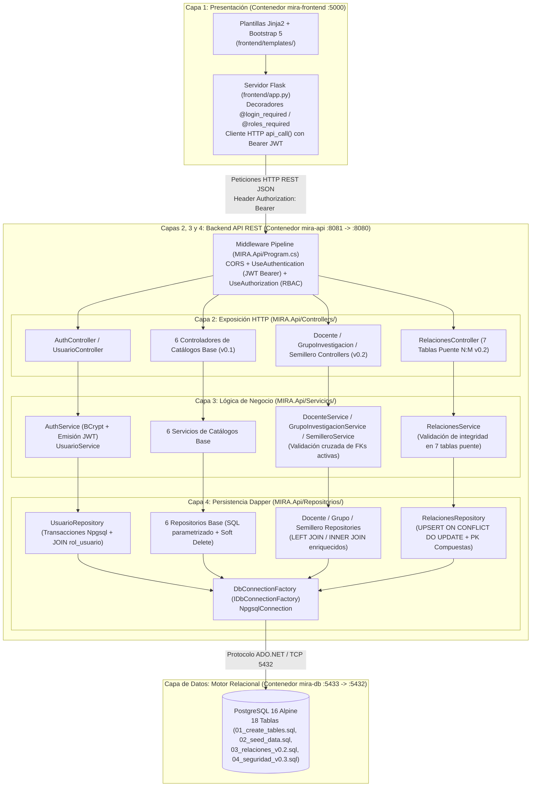
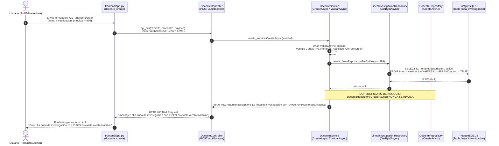
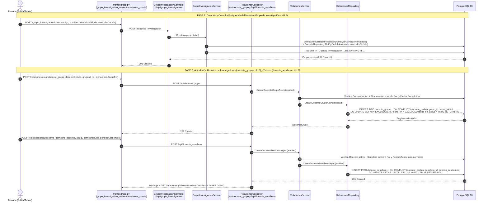
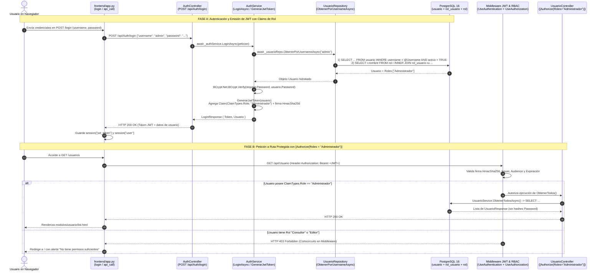

# MANUAL MAESTRO DE ARQUITECTURA, DISEÑO DE SOFTWARE Y ESPECIFICACIONES TÉCNICAS (SPEC KIT) — PROYECTO MIRA

> **Proyecto:** MIRA (Mapa de Investigación y Registro Académico)  
> **Stack Principal:** .NET 7 (`MIRA.Api`), Dapper Micro-ORM, PostgreSQL 16 (`database/`), Python 3.11 + Flask + Jinja2 + Bootstrap 5 (`frontend/`), Docker Compose  
> **Metodología:** Spec-Driven Development (SDD) — Versiones `v0.1` (Catálogos Base), `v0.2` (Ecosistema Relacional e Investigación) y `v0.3` (Seguridad RBAC, Hashing BCrypt y Autenticación JWT)

---

## SECCIÓN 1: Arquitectura del Sistema y Diseño de Software (Con Código Real)

### 1.1. Arquitectura General y Diseño de Software

El sistema **MIRA (Mapa de Investigación y Registro Académico)** implementa una **Arquitectura Multicapa (N-Tier) Estricta y Desacoplada**, diseñada bajo los lineamientos de **Spec-Driven Development (SDD)** definidos en `docs/1_constitution.md` y `docs/ARQUITECTURA.md`.

#### Las 4 Capas del Sistema MIRA

1. **Capa de Presentación / Cliente Web (`frontend/`):**
   - Construida en **Python 3.11** con el microframework **Flask**, motor de plantillas **Jinja2**, **Bootstrap 5** y la librería HTTP **`requests`**.
   - **Aislamiento Total de Datos:** No posee drivers de base de datos (`psycopg2` ni SQLAlchemy) ni conexión alguna hacia PostgreSQL. Toda lectura o mutación viaja exclusivamente por red mediante peticiones HTTP JSON hacia `http://mira-api:8080/api` (o `http://localhost:8081/api` en entorno host) a través de la función centralizada `api_call()`, que inyecta automáticamente el encabezado `Authorization: Bearer <jwt_token>`.
2. **Capa de Exposición / Controladores REST (`MIRA.Api/Controllers/`):**
   - Compuesta por 12 controladores `ControllerBase` de ASP.NET Core 7 (`AreaConocimientoController`, `ObjetivoDesarrolloSostenibleController`, `AreaAplicacionController`, `TerminoClaveController`, `UniversidadController`, `LineaInvestigacionController`, `DocenteController`, `GrupoInvestigacionController`, `SemilleroController`, `RelacionesController`, `AuthController` y `UsuarioController`).
   - **Responsabilidad Única:** Recibir el payload HTTP (entidad o DTO), aplicar seguridad declarativa mediante atributos `[Authorize]` y `[Authorize(Roles = "...")]`, delegar la operación al Servicio inyectado y traducir el resultado o las excepciones (`ArgumentException`, `KeyNotFoundException`, `UnauthorizedAccessException`, `PostgresException`) a códigos de estado HTTP estándar (`200 OK`, `201 Created`, `400 Bad Request`, `401 Unauthorized`, `403 Forbidden`, `404 Not Found`, `409 Conflict`, `500 Internal Server Error`). **No contiene lógica de negocio ni sentencias SQL.**
3. **Capa de Lógica de Negocio / Servicios (`MIRA.Api/Servicios/`):**
   - Contiene las interfaces (`I*Service.cs`) y sus implementaciones (`*Service.cs`) para cada módulo del dominio y para la autenticación/gestión de usuarios (`AuthService`, `UsuarioService`).
   - **Responsabilidad Única:** Validar las invariantes del dominio (campos obligatorios, longitudes máximas, formatos de correo, validación previa de existencia y estado `activo = true` de claves foráneas en otros repositorios antes de insertar o actualizar, verificación de contraseñas con BCrypt y generación de tokens JWT). Cuando una regla de negocio falla, lanza `ArgumentException` o `KeyNotFoundException` y **aborta la ejecución antes de tocar el repositorio principal**.
4. **Capa de Persistencia / Repositorios (`MIRA.Api/Repositorios/`):**
   - Implementa el patrón **Repository** sobre **Dapper** y **Npgsql** consumiendo la fábrica `IDbConnectionFactory` (`MIRA.Api/Configuracion/DbConnectionFactory.cs`).
   - **Filosofía "SQL a la Vista":** Prohíbe el uso de Entity Framework o generadores opacos de consultas. Todas las sentencias SQL (`SELECT`, `INSERT ... RETURNING`, `UPDATE`, `ON CONFLICT DO UPDATE`) están escritas explícitamente con parámetros `@Parametro` seguros contra inyección SQL, uniones `LEFT JOIN` / `INNER JOIN` para poblar propiedades enriquecidas de lectura, y soporte transaccional (`BeginTransaction()`) para operaciones compuestas.

#### Tecnologías y Paquetes Reales en `MIRA.Api/MIRA.Api.csproj`

El archivo de proyecto define explícitamente el framework `.NET 7.0` y las 6 dependencias NuGet que sustentan la arquitectura:

```xml
<!-- Ruta: MIRA.Api/MIRA.Api.csproj -->
<Project Sdk="Microsoft.NET.Sdk.Web">

  <PropertyGroup>
    <TargetFramework>net7.0</TargetFramework>
    <Nullable>enable</Nullable>
    <ImplicitUsings>enable</ImplicitUsings>
  </PropertyGroup>

  <ItemGroup>   
    <PackageReference Include="Microsoft.AspNetCore.OpenApi" Version="7.0.5" />
    <PackageReference Include="Swashbuckle.AspNetCore" Version="6.4.0" />
    <!-- Driver oficial de PostgreSQL para .NET -->
    <PackageReference Include="Npgsql" Version="7.0.7" />
    <!-- Micro-ORM ligero para mantener el "SQL a la vista" -->
    <PackageReference Include="Dapper" Version="2.1.35" />
    <!-- Seguridad v0.3: Hashing BCrypt y Autenticación JWT -->
    <PackageReference Include="BCrypt.Net-Next" Version="4.0.3" />
    <PackageReference Include="Microsoft.AspNetCore.Authentication.JwtBearer" Version="7.0.20" />
  </ItemGroup>

</Project>
```

| Paquete NuGet | Versión | Rol Arquitectónico en MIRA |
| :--- | :--- | :--- |
| `Dapper` | `2.1.35` | Micro-ORM de alto rendimiento que ejecuta SQL nativo parametrizado y mapea columnas `snake_case` de PostgreSQL a propiedades `PascalCase` de C# (`DefaultTypeMap.MatchNamesWithUnderscores = true`). |
| `Npgsql` | `7.0.7` | Proveedor ADO.NET oficial para PostgreSQL 16; gestiona el pool de conexiones `NpgsqlConnection` y expone códigos SQLSTATE (`PostgresException.SqlState == "23505"` para colisiones `UNIQUE`/`PK`). |
| `BCrypt.Net-Next` | `4.0.3` | Algoritmo de hashing adaptativo con sal criptográfica (`BCrypt.Net.BCrypt.HashPassword` y `Verify`) para almacenar y verificar contraseñas en la tabla `usuario`. |
| `Microsoft.AspNetCore.Authentication.JwtBearer` | `7.0.20` | Middleware de autenticación que valida la firma `HmacSha256`, emisor (`MIRA_Api`), audiencia (`MIRA_Client`) y expiración de los tokens JWT Bearer, poblando `HttpContext.User` y sus `ClaimTypes.Role`. |
| `Swashbuckle.AspNetCore` | `6.4.0` | Generador de especificación OpenAPI 3.0 e interfaz interactiva Swagger UI configurada con esquema de seguridad `Bearer` para pruebas con token JWT. |
| `Microsoft.AspNetCore.OpenApi` | `7.0.5` | Soporte base de metadatos OpenAPI para endpoints de ASP.NET Core 7. |

#### Patrones de Diseño Aplicados

- **Repository Pattern con Interfaces:** Cada entidad o agregado de relaciones tiene un contrato (`IDocenteRepository`, `IRelacionesRepository`, `IUsuarioRepository`, etc.) separado de su implementación SQL en Dapper.
- **Inyección de Dependencias (DI Container Nativo):** Uso de `AddSingleton<IDbConnectionFactory, DbConnectionFactory>()` para la factoría de conexiones y `AddScoped<TI, TImpl>()` para repositorios y servicios por cada petición HTTP.
- **Patrón DTO (Data Transfer Objects) en `MIRA.Api/Peticiones/`:** Separación estricta entre la entidad de base de datos `Usuario` (que contiene el hash `Password` y metadatos internos) y los contratos públicos de entrada/salida (`LoginRequest`, `LoginResponse`, `UsuarioAuthDto`, `UsuarioCrear`, `UsuarioResponse`), evitando fugas de datos sensibles.
- **Borrado Lógico Constitucional (`Soft Delete`):** Ninguna de las 18 tablas admite `DELETE FROM` físico desde la aplicación. Toda eliminación ejecuta `UPDATE <tabla> SET activo = FALSE WHERE ...`, y todo listado o búsqueda filtra por `WHERE activo = TRUE`. En tablas puente con clave primaria compuesta (`RelacionesRepository`), cuando una relación previamente desactivada vuelve a insertarse, se aplica el patrón **`UPSERT` de reactivación (`ON CONFLICT (...) DO UPDATE SET activo = TRUE`)**.
- **Patrón Maestro-Detalle y Articulación N:M:** Las entidades maestras (`grupo_investigacion`, `semillero`, `linea_investigacion`) se gestionan en sus propios controladores y servicios, mientras que el detalle de sus integrantes, tutores y articulaciones temáticas se coordina mediante `RelacionesController` -> `RelacionesService` -> `RelacionesRepository` sobre las 7 tablas puente con claves primarias compuestas.

#### Diagrama de Arquitectura Multicapa de MIRA



---

### 1.2. Radiografía por Capas con Fragmentos de Código Real

#### a) Punto de Entrada, Factoría de Conexiones e Inyección de Dependencias (`MIRA.Api/Program.cs` y `MIRA.Api/Configuracion/DbConnectionFactory.cs`)

El archivo `MIRA.Api/Configuracion/DbConnectionFactory.cs` encapsula la creación de instancias `NpgsqlConnection` a partir de la cadena `DefaultConnection` inyectada desde `appsettings.json` o variables de entorno de Docker (`ConnectionStrings__DefaultConnection`):

```csharp
// Ruta: MIRA.Api/Configuracion/DbConnectionFactory.cs
using System.Data;
using Npgsql;

namespace MIRA.Api.Configuracion;

public interface IDbConnectionFactory
{
    IDbConnection CreateConnection();
}

public class DbConnectionFactory : IDbConnectionFactory
{
    private readonly string _connectionString;

    public DbConnectionFactory(IConfiguration configuration)
    {
        _connectionString = configuration.GetConnectionString("DefaultConnection")
            ?? throw new InvalidOperationException("No se encontró la cadena de conexión 'DefaultConnection'.");
    }

    public IDbConnection CreateConnection()
    {
        return new NpgsqlConnection(_connectionString);
    }
}
```

Por su parte, `MIRA.Api/Program.cs` configura el mapeo global de Dapper (`DefaultTypeMap.MatchNamesWithUnderscores = true`), el esquema de seguridad JWT en Swagger, el middleware `JwtBearerDefaults.AuthenticationScheme`, y registra los repositorios y servicios de las 3 fases evolutivas del proyecto:

```csharp
// Ruta: MIRA.Api/Program.cs
using System.Text;
using Dapper;
using Microsoft.AspNetCore.Authentication.JwtBearer;
using Microsoft.IdentityModel.Tokens;
using Microsoft.OpenApi.Models;
using MIRA.Api.Configuracion;
using MIRA.Api.Repositorios;
using MIRA.Api.Servicios;

// Habilitar el mapeo automático de Dapper de snake_case (SQL) a PascalCase (C#)
DefaultTypeMap.MatchNamesWithUnderscores = true;

var builder = WebApplication.CreateBuilder(args);

// 1. Configurar servicios base de ASP.NET Core
builder.Services.AddControllers();
builder.Services.AddEndpointsApiExplorer();

// Configuración de Swagger soportando autenticación Bearer JWT (v0.3)
builder.Services.AddSwaggerGen(c =>
{
    c.SwaggerDoc("v1", new OpenApiInfo
    {
        Title = "MIRA API - Mapa de Investigación y Registro Académico",
        Version = "v0.3",
        Description = "API RESTful para el sistema MIRA con soporte de Control de Acceso Basado en Roles (RBAC) y Autenticación JWT."
    });

    c.AddSecurityDefinition("Bearer", new OpenApiSecurityScheme
    {
        Description = "Autenticación JWT usando el esquema Bearer. Ejemplo: 'Bearer {token}'",
        Name = "Authorization",
        In = ParameterLocation.Header,
        Type = SecuritySchemeType.ApiKey,
        Scheme = "Bearer"
    });

    c.AddSecurityRequirement(new OpenApiSecurityRequirement
    {
        {
            new OpenApiSecurityScheme
            {
                Reference = new OpenApiReference
                {
                    Type = ReferenceType.SecurityScheme,
                    Id = "Bearer"
                },
                Scheme = "oauth2",
                Name = "Bearer",
                In = ParameterLocation.Header
            },
            new List<string>()
        }
    });
});

// 2. Configurar CORS para permitir peticiones del futuro Frontend
builder.Services.AddCors(options =>
{
    options.AddPolicy("CorsPolicy", policy =>
    {
        policy.AllowAnyOrigin()
              .AllowAnyMethod()
              .AllowAnyHeader();
    });
});

// 3. Configurar Autenticación JWT (v0.3)
var jwtKey = builder.Configuration["JwtSettings:Key"] ?? "ClaveSecretaSuperSeguraParaDesarrolloMIRA2026_Minimo32Bytes!";
var jwtIssuer = builder.Configuration["JwtSettings:Issuer"] ?? "MIRA_Api";
var jwtAudience = builder.Configuration["JwtSettings:Audience"] ?? "MIRA_Client";

builder.Services.AddAuthentication(options =>
{
    options.DefaultAuthenticateScheme = JwtBearerDefaults.AuthenticationScheme;
    options.DefaultChallengeScheme = JwtBearerDefaults.AuthenticationScheme;
})
.AddJwtBearer(options =>
{
    options.RequireHttpsMetadata = false;
    options.SaveToken = true;
    options.TokenValidationParameters = new TokenValidationParameters
    {
        ValidateIssuerSigningKey = true,
        IssuerSigningKey = new SymmetricSecurityKey(Encoding.UTF8.GetBytes(jwtKey)),
        ValidateIssuer = true,
        ValidIssuer = jwtIssuer,
        ValidateAudience = true,
        ValidAudience = jwtAudience,
        ValidateLifetime = true,
        ClockSkew = TimeSpan.Zero
    };
});

builder.Services.AddAuthorization();

// 4. Registrar la fábrica de conexiones a PostgreSQL (Dapper)
builder.Services.AddSingleton<IDbConnectionFactory, DbConnectionFactory>();

// 5. Inyección de Dependencias - Repositorios y Servicios (Fase 1: 6 tablas sin FK)
builder.Services.AddScoped<IAreaConocimientoRepository, AreaConocimientoRepository>();
builder.Services.AddScoped<IAreaConocimientoService, AreaConocimientoService>();

builder.Services.AddScoped<IObjetivoDesarrolloSostenibleRepository, ObjetivoDesarrolloSostenibleRepository>();
builder.Services.AddScoped<IObjetivoDesarrolloSostenibleService, ObjetivoDesarrolloSostenibleService>();

builder.Services.AddScoped<IAreaAplicacionRepository, AreaAplicacionRepository>();
builder.Services.AddScoped<IAreaAplicacionService, AreaAplicacionService>();

builder.Services.AddScoped<ITerminoClaveRepository, TerminoClaveRepository>();
builder.Services.AddScoped<ITerminoClaveService, TerminoClaveService>();

builder.Services.AddScoped<IUniversidadRepository, UniversidadRepository>();
builder.Services.AddScoped<IUniversidadService, UniversidadService>();

builder.Services.AddScoped<ILineaInvestigacionRepository, LineaInvestigacionRepository>();
builder.Services.AddScoped<ILineaInvestigacionService, LineaInvestigacionService>();

// 6. Inyección de Dependencias - Repositorios y Servicios (Fase 2: Entidades Relacionales y Tablas Puente)
builder.Services.AddScoped<IDocenteRepository, DocenteRepository>();
builder.Services.AddScoped<IDocenteService, DocenteService>();

builder.Services.AddScoped<IGrupoInvestigacionRepository, GrupoInvestigacionRepository>();
builder.Services.AddScoped<IGrupoInvestigacionService, GrupoInvestigacionService>();

builder.Services.AddScoped<ISemilleroRepository, SemilleroRepository>();
builder.Services.AddScoped<ISemilleroService, SemilleroService>();

builder.Services.AddScoped<IRelacionesRepository, RelacionesRepository>();
builder.Services.AddScoped<IRelacionesService, RelacionesService>();

// 7. Inyección de Dependencias - Seguridad y Autenticación (Fase 3: v0.3)
builder.Services.AddScoped<IUsuarioRepository, UsuarioRepository>();
builder.Services.AddScoped<IUsuarioService, UsuarioService>();
builder.Services.AddScoped<IAuthService, AuthService>();

var app = builder.Build();

// Configurar el pipeline HTTP
app.UseSwagger();
app.UseSwaggerUI(c =>
{
    c.SwaggerEndpoint("/swagger/v1/swagger.json", "MIRA API v0.3");
});

app.UseCors("CorsPolicy");

app.UseAuthentication();
app.UseAuthorization();

app.MapControllers();

app.Run();
```

**Qué hace y qué valida `Program.cs`:**
- Activa `DefaultTypeMap.MatchNamesWithUnderscores = true`, lo que permite que columnas SQL como `linea_investigacion_principal` o `categoria_minciencias` se hidraten automáticamente en las propiedades C# `LineaInvestigacionPrincipal` y `CategoriaMinciencias` sin requerir alias manuales en cada columna.
- Configura la validación criptográfica del JWT con `ClockSkew = TimeSpan.Zero` para que la expiración del token sea exacta al segundo.
- Registra el orden estricto de middlewares: `UseCors` -> `UseAuthentication` -> `UseAuthorization` -> `MapControllers`.

---

#### b) Capa de Controladores (`MIRA.Api/Controllers/`)

Los controladores actúan como adaptadores HTTP puros. A continuación se muestran fragmentos reales de `DocenteController.cs`, `RelacionesController.cs` y `UsuarioController.cs`.

##### 1. `MIRA.Api/Controllers/DocenteController.cs`

```csharp
// Ruta: MIRA.Api/Controllers/DocenteController.cs
using Microsoft.AspNetCore.Authorization;
using Microsoft.AspNetCore.Mvc;
using MIRA.Api.Modelos;
using MIRA.Api.Servicios;
using Npgsql;

namespace MIRA.Api.Controllers;

[ApiController]
[Route("api/docente")]
[Authorize]
public class DocenteController : ControllerBase
{
    private readonly IDocenteService _service;

    public DocenteController(IDocenteService service)
    {
        _service = service;
    }

    [HttpGet]
    public async Task<IActionResult> GetAll()
    {
        var lista = await _service.GetAllActivosAsync();
        return Ok(lista);
    }

    [HttpGet("{cedula:int}")]
    public async Task<IActionResult> GetByCedula(int cedula)
    {
        var item = await _service.GetByCedulaAsync(cedula);
        if (item is null)
            return NotFound(new { mensaje = $"No se encontró un docente activo con cédula {cedula}." });

        return Ok(item);
    }

    [HttpPost]
    [Authorize(Roles = "Administrador,Editor")]
    public async Task<IActionResult> Create([FromBody] Docente entidad)
    {
        try
        {
            var creado = await _service.CreateAsync(entidad);
            return CreatedAtAction(nameof(GetByCedula), new { cedula = creado.Cedula }, creado);
        }
        catch (ArgumentException ex)
        {
            return BadRequest(new { mensaje = ex.Message });
        }
        catch (PostgresException ex) when (ex.SqlState == "23505")
        {
            return Conflict(new { mensaje = $"Ya existe un docente registrado con la cédula {entidad.Cedula} o correo {entidad.Correo}." });
        }
    }

    [HttpPut("{cedula:int}")]
    [Authorize(Roles = "Administrador,Editor")]
    public async Task<IActionResult> Update(int cedula, [FromBody] Docente entidad)
    {
        try
        {
            var actualizado = await _service.UpdateAsync(cedula, entidad);
            if (!actualizado)
                return NotFound(new { mensaje = $"No se encontró un docente activo con cédula {cedula} para actualizar." });

            var item = await _service.GetByCedulaAsync(cedula);
            return Ok(item);
        }
        catch (ArgumentException ex)
        {
            return BadRequest(new { mensaje = ex.Message });
        }
        catch (PostgresException ex) when (ex.SqlState == "23505")
        {
            return Conflict(new { mensaje = $"El correo '{entidad.Correo}' ya está asignado a otro docente." });
        }
    }

    [HttpDelete("{cedula:int}")]
    [Authorize(Roles = "Administrador")]
    public async Task<IActionResult> Delete(int cedula)
    {
        var eliminado = await _service.SoftDeleteAsync(cedula);
        if (!eliminado)
            return NotFound(new { mensaje = $"No se encontró un docente activo con cédula {cedula} para desactivar." });

        return Ok(new { mensaje = $"Docente con cédula {cedula} desactivado correctamente (borrado lógico)." });
    }
}
```

##### 2. `MIRA.Api/Controllers/RelacionesController.cs` (Fragmento de articulación `docente_grupo` y `docente_semillero`)

```csharp
// Ruta: MIRA.Api/Controllers/RelacionesController.cs
using Microsoft.AspNetCore.Authorization;
using Microsoft.AspNetCore.Mvc;
using MIRA.Api.Modelos;
using MIRA.Api.Servicios;

namespace MIRA.Api.Controllers;

/// <summary>
/// Controlador unificado para gestionar las 7 tablas puente (relaciones muchos a muchos) de la Entrega 2.
/// </summary>
[ApiController]
[Route("api")]
[Authorize]
public class RelacionesController : ControllerBase
{
    private readonly IRelacionesService _service;

    public RelacionesController(IRelacionesService service)
    {
        _service = service;
    }

    // 1. DOCENTE - GRUPO (HU 5)
    [HttpGet("docente_grupo")]
    public async Task<IActionResult> GetAllDocenteGrupo() => Ok(await _service.GetAllDocenteGrupoAsync());

    [HttpPost("docente_grupo")]
    [Authorize(Roles = "Administrador,Editor")]
    public async Task<IActionResult> CreateDocenteGrupo([FromBody] DocenteGrupo entidad)
    {
        try
        {
            var creado = await _service.CreateDocenteGrupoAsync(entidad);
            return StatusCode(201, creado);
        }
        catch (ArgumentException ex)
        {
            return BadRequest(new { mensaje = ex.Message });
        }
    }

    [HttpDelete("docente_grupo")]
    [Authorize(Roles = "Administrador")]
    public async Task<IActionResult> DeleteDocenteGrupo([FromQuery] int docenteCedula, [FromQuery] int grupoId)
    {
        var eliminado = await _service.SoftDeleteDocenteGrupoAsync(docenteCedula, grupoId);
        if (!eliminado)
            return NotFound(new { mensaje = "No se encontró una vinculación activa entre el docente y el grupo especificado." });

        return Ok(new { mensaje = "Vinculación docente-grupo desactivada correctamente." });
    }

    // 2. DOCENTE - SEMILLERO (HU 6)
    [HttpGet("docente_semillero")]
    public async Task<IActionResult> GetAllDocenteSemillero() => Ok(await _service.GetAllDocenteSemilleroAsync());

    [HttpPost("docente_semillero")]
    [Authorize(Roles = "Administrador,Editor")]
    public async Task<IActionResult> CreateDocenteSemillero([FromBody] DocenteSemillero entidad)
    {
        try
        {
            var creado = await _service.CreateDocenteSemilleroAsync(entidad);
            return StatusCode(201, creado);
        }
        catch (ArgumentException ex)
        {
            return BadRequest(new { mensaje = ex.Message });
        }
    }

    [HttpDelete("docente_semillero")]
    [Authorize(Roles = "Administrador")]
    public async Task<IActionResult> DeleteDocenteSemillero(
        [FromQuery] int docenteCedula,
        [FromQuery] int semilleroId,
        [FromQuery] string periodoAcademico)
    {
        var eliminado = await _service.SoftDeleteDocenteSemilleroAsync(docenteCedula, semilleroId, periodoAcademico);
        if (!eliminado)
            return NotFound(new { mensaje = "No se encontró la asignación docente-semillero activa para ese periodo." });

        return Ok(new { mensaje = "Asignación docente-semillero desactivada correctamente." });
    }
}
```

##### 3. `MIRA.Api/Controllers/UsuarioController.cs`

```csharp
// Ruta: MIRA.Api/Controllers/UsuarioController.cs
using System;
using System.Threading.Tasks;
using Microsoft.AspNetCore.Authorization;
using Microsoft.AspNetCore.Mvc;
using MIRA.Api.Peticiones;
using MIRA.Api.Servicios;

namespace MIRA.Api.Controllers
{
    [ApiController]
    [Route("api/[controller]")]
    [Authorize(Roles = "Administrador")]
    public class UsuarioController : ControllerBase
    {
        private readonly IUsuarioService _usuarioService;

        public UsuarioController(IUsuarioService usuarioService)
        {
            _usuarioService = usuarioService;
        }

        [HttpGet]
        public async Task<IActionResult> ObtenerTodos()
        {
            var usuarios = await _usuarioService.ObtenerTodosAsync();
            return Ok(new { exito = true, datos = usuarios });
        }

        [HttpGet("{id}")]
        public async Task<IActionResult> ObtenerPorId(int id)
        {
            try
            {
                var usuario = await _usuarioService.ObtenerPorIdAsync(id);
                return Ok(new { exito = true, datos = usuario });
            }
            catch (KeyNotFoundException ex)
            {
                return NotFound(new { exito = false, mensaje = ex.Message });
            }
        }

        [HttpPost]
        public async Task<IActionResult> Crear([FromBody] UsuarioCrear peticion)
        {
            if (!ModelState.IsValid)
                return BadRequest(ModelState);

            try
            {
                var creado = await _usuarioService.CrearAsync(peticion);
                return CreatedAtAction(nameof(ObtenerPorId), new { id = creado.Id }, new
                {
                    exito = true,
                    mensaje = "Usuario registrado exitosamente.",
                    datos = creado
                });
            }
            catch (ArgumentException ex)
            {
                return BadRequest(new { exito = false, mensaje = ex.Message });
            }
        }

        [HttpDelete("{id}")]
        public async Task<IActionResult> Eliminar(int id)
        {
            try
            {
                await _usuarioService.EliminarAsync(id);
                return Ok(new { exito = true, mensaje = "Usuario desactivado correctamente (Borrado lógico)." });
            }
            catch (KeyNotFoundException ex)
            {
                return NotFound(new { exito = false, mensaje = ex.Message });
            }
        }
    }
}
```

**Qué hace y qué valida la Capa de Controladores:**
- `DocenteController` y `RelacionesController` aplican `[Authorize]` a nivel de clase (cualquier usuario autenticado como `Consultor`, `Editor` o `Administrador` puede ejecutar `GET`), `[Authorize(Roles = "Administrador,Editor")]` en `POST`/`PUT` y `[Authorize(Roles = "Administrador")]` en `DELETE`.
- `UsuarioController` aplica `[Authorize(Roles = "Administrador")]` a nivel de toda la clase, bloqueando con `403 Forbidden` a cualquier rol distinto de `Administrador`.
- Capturan `ArgumentException` lanzadas por la capa de Servicios y las transforman en `400 Bad Request` con formato JSON `{ mensaje = ex.Message }`, además de interceptar `PostgresException` con `SqlState == "23505"` (violación de restricción `UNIQUE` o `PRIMARY KEY`) para retornar `409 Conflict`.

---

#### c) Capa de Servicios / Lógica de Negocio (`MIRA.Api/Servicios/`)

A continuación se presentan los fragmentos reales completos de `DocenteService.cs` y `AuthService.cs`.

##### 1. `MIRA.Api/Servicios/DocenteService.cs`

```csharp
// Ruta: MIRA.Api/Servicios/DocenteService.cs
using MIRA.Api.Modelos;
using MIRA.Api.Repositorios;

namespace MIRA.Api.Servicios;

public class DocenteService : IDocenteService
{
    private readonly IDocenteRepository _repository;
    private readonly ILineaInvestigacionRepository _lineaRepository;

    public DocenteService(
        IDocenteRepository repository,
        ILineaInvestigacionRepository lineaRepository)
    {
        _repository = repository;
        _lineaRepository = lineaRepository;
    }

    public Task<IEnumerable<Docente>> GetAllActivosAsync() => _repository.GetAllActivosAsync();

    public Task<Docente?> GetByCedulaAsync(int cedula) => _repository.GetByCedulaAsync(cedula);

    public async Task<Docente> CreateAsync(Docente entidad)
    {
        await ValidarAsync(entidad);
        entidad.Activo = true;
        return await _repository.CreateAsync(entidad);
    }

    public async Task<bool> UpdateAsync(int cedula, Docente entidad)
    {
        if (cedula <= 0)
            throw new ArgumentException("La cédula proporcionada en la ruta no es válida.");

        await ValidarAsync(entidad, validarCedulaEnBody: false);
        return await _repository.UpdateAsync(cedula, entidad);
    }

    public Task<bool> SoftDeleteAsync(int cedula) => _repository.SoftDeleteAsync(cedula);

    private async Task ValidarAsync(Docente entidad, bool validarCedulaEnBody = true)
    {
        if (validarCedulaEnBody && entidad.Cedula <= 0)
            throw new ArgumentException("El campo 'cedula' debe ser un número entero positivo válido.");

        if (string.IsNullOrWhiteSpace(entidad.Nombres))
            throw new ArgumentException("El campo 'nombres' es obligatorio.");

        if (string.IsNullOrWhiteSpace(entidad.Apellidos))
            throw new ArgumentException("El campo 'apellidos' es obligatorio.");

        if (string.IsNullOrWhiteSpace(entidad.Correo) || !entidad.Correo.Contains('@'))
            throw new ArgumentException("El campo 'correo' es obligatorio y debe tener un formato válido.");

        // Validar existencia de la línea de investigación principal si fue especificada
        if (entidad.LineaInvestigacionPrincipal.HasValue)
        {
            var linea = await _lineaRepository.GetByIdAsync(entidad.LineaInvestigacionPrincipal.Value);
            if (linea is null)
                throw new ArgumentException($"La línea de investigación con ID {entidad.LineaInvestigacionPrincipal.Value} no existe o está inactiva.");
        }
    }
}
```

##### 2. `MIRA.Api/Servicios/AuthService.cs`

```csharp
// Ruta: MIRA.Api/Servicios/AuthService.cs
using System;
using System.Collections.Generic;
using System.IdentityModel.Tokens.Jwt;
using System.Security.Claims;
using System.Text;
using System.Threading.Tasks;
using Microsoft.Extensions.Configuration;
using Microsoft.IdentityModel.Tokens;
using MIRA.Api.Modelos;
using MIRA.Api.Peticiones;
using MIRA.Api.Repositorios;

namespace MIRA.Api.Servicios
{
    public class AuthService : IAuthService
    {
        private readonly IUsuarioRepository _usuarioRepo;
        private readonly IConfiguration _config;

        public AuthService(IUsuarioRepository usuarioRepo, IConfiguration config)
        {
            _usuarioRepo = usuarioRepo;
            _config = config;
        }

        public async Task<LoginResponse> LoginAsync(LoginRequest request)
        {
            var usuario = await _usuarioRepo.ObtenerPorUsernameAsync(request.Username);
            if (usuario == null)
                throw new UnauthorizedAccessException("Credenciales inválidas o usuario inactivo.");

            bool passwordValido = BCrypt.Net.BCrypt.Verify(request.Password, usuario.Password);
            if (!passwordValido)
                throw new UnauthorizedAccessException("Credenciales inválidas o usuario inactivo.");

            string token = GenerarJwtToken(usuario);

            return new LoginResponse
            {
                Token = token,
                Usuario = new UsuarioAuthDto
                {
                    Username = usuario.Username,
                    NombreCompleto = usuario.NombreCompleto,
                    Roles = usuario.Roles
                }
            };
        }

        private string GenerarJwtToken(Usuario usuario)
        {
            var jwtKey = _config["JwtSettings:Key"] ?? "ClaveSecretaSuperSeguraParaDesarrolloMIRA2026_Minimo32Bytes!";
            var jwtIssuer = _config["JwtSettings:Issuer"] ?? "MIRA_Api";
            var jwtAudience = _config["JwtSettings:Audience"] ?? "MIRA_Client";
            var expireMinutes = int.TryParse(_config["JwtSettings:ExpireMinutes"], out int exp) ? exp : 120;

            var securityKey = new SymmetricSecurityKey(Encoding.UTF8.GetBytes(jwtKey));
            var credentials = new SigningCredentials(securityKey, SecurityAlgorithms.HmacSha256);

            var claims = new List<Claim>
            {
                new Claim(JwtRegisteredClaimNames.Sub, usuario.Username),
                new Claim(JwtRegisteredClaimNames.Jti, Guid.NewGuid().ToString()),
                new Claim("id", usuario.Id.ToString()),
                new Claim("email", usuario.Email)
            };

            foreach (var rol in usuario.Roles)
            {
                claims.Add(new Claim(ClaimTypes.Role, rol));
            }

            var token = new JwtSecurityToken(
                issuer: jwtIssuer,
                audience: jwtAudience,
                claims: claims,
                expires: DateTime.UtcNow.AddMinutes(expireMinutes),
                signingCredentials: credentials);

            return new JwtSecurityTokenHandler().WriteToken(token);
        }
    }
}
```

**Qué hace y qué valida la Capa de Servicios:**
- En `DocenteService.ValidarAsync`, antes de invocar `_repository.CreateAsync` o `UpdateAsync`, verifica reglas de formato (`Cedula > 0`, `Nombres`, `Apellidos`, `Correo` con `'@'`) y realiza una **validación de integridad referencial en capa de negocio**: si `LineaInvestigacionPrincipal.HasValue`, consulta `_lineaRepository.GetByIdAsync(...)`. Si la línea no existe o tiene `activo = false`, lanza `ArgumentException` y detiene el flujo sin tocar la tabla `docente`.
- En `AuthService.LoginAsync`, busca el usuario activo por `Username`, verifica el texto plano contra el hash almacenado mediante `BCrypt.Net.BCrypt.Verify`, e incrusta cada rol del usuario como un `Claim(ClaimTypes.Role, rol)` dentro del token firmado con `HmacSha256`.

---

#### d) Capa de Repositorios / Persistencia (`MIRA.Api/Repositorios/`)

A continuación se muestran fragmentos reales de `DocenteRepository.cs`, `RelacionesRepository.cs` y `UsuarioRepository.cs` con su "SQL a la vista".

##### 1. `MIRA.Api/Repositorios/DocenteRepository.cs`

```csharp
// Ruta: MIRA.Api/Repositorios/DocenteRepository.cs
using Dapper;
using MIRA.Api.Configuracion;
using MIRA.Api.Modelos;

namespace MIRA.Api.Repositorios;

public class DocenteRepository : IDocenteRepository
{
    private readonly IDbConnectionFactory _connectionFactory;

    public DocenteRepository(IDbConnectionFactory connectionFactory)
    {
        _connectionFactory = connectionFactory;
    }

    public async Task<IEnumerable<Docente>> GetAllActivosAsync()
    {
        const string sql = @"
            SELECT d.cedula, d.nombres, d.apellidos, d.correo, d.enlace_cvlac,
                   d.escalafon, d.categoria_minciencias, d.linea_investigacion_principal,
                   l.nombre AS linea_investigacion_nombre, d.activo
            FROM docente d
            LEFT JOIN linea_investigacion l ON d.linea_investigacion_principal = l.id
            WHERE d.activo = TRUE
            ORDER BY d.apellidos, d.nombres;";

        using var connection = _connectionFactory.CreateConnection();
        return await connection.QueryAsync<Docente>(sql);
    }

    public async Task<Docente?> GetByCedulaAsync(int cedula)
    {
        const string sql = @"
            SELECT d.cedula, d.nombres, d.apellidos, d.correo, d.enlace_cvlac,
                   d.escalafon, d.categoria_minciencias, d.linea_investigacion_principal,
                   l.nombre AS linea_investigacion_nombre, d.activo
            FROM docente d
            LEFT JOIN linea_investigacion l ON d.linea_investigacion_principal = l.id
            WHERE d.cedula = @Cedula AND d.activo = TRUE;";

        using var connection = _connectionFactory.CreateConnection();
        return await connection.QueryFirstOrDefaultAsync<Docente>(sql, new { Cedula = cedula });
    }

    public async Task<Docente> CreateAsync(Docente entidad)
    {
        const string sql = @"
            INSERT INTO docente (cedula, nombres, apellidos, correo, enlace_cvlac,
                                 escalafon, categoria_minciencias, linea_investigacion_principal, activo)
            VALUES (@Cedula, @Nombres, @Apellidos, @Correo, @EnlaceCvlac,
                    @Escalafon, @CategoriaMinciencias, @LineaInvestigacionPrincipal, @Activo)
            RETURNING cedula, nombres, apellidos, correo, enlace_cvlac,
                      escalafon, categoria_minciencias, linea_investigacion_principal, activo;";

        using var connection = _connectionFactory.CreateConnection();
        return await connection.QuerySingleAsync<Docente>(sql, entidad);
    }

    public async Task<bool> UpdateAsync(int cedula, Docente entidad)
    {
        const string sql = @"
            UPDATE docente
            SET nombres = @Nombres,
                apellidos = @Apellidos,
                correo = @Correo,
                enlace_cvlac = @EnlaceCvlac,
                escalafon = @Escalafon,
                categoria_minciencias = @CategoriaMinciencias,
                linea_investigacion_principal = @LineaInvestigacionPrincipal
            WHERE cedula = @Cedula AND activo = TRUE;";

        using var connection = _connectionFactory.CreateConnection();
        var filas = await connection.ExecuteAsync(sql, new
        {
            Cedula = cedula,
            entidad.Nombres,
            entidad.Apellidos,
            entidad.Correo,
            entidad.EnlaceCvlac,
            entidad.Escalafon,
            entidad.CategoriaMinciencias,
            entidad.LineaInvestigacionPrincipal
        });
        return filas > 0;
    }

    public async Task<bool> SoftDeleteAsync(int cedula)
    {
        const string sql = @"
            UPDATE docente
            SET activo = FALSE
            WHERE cedula = @Cedula AND activo = TRUE;";

        using var connection = _connectionFactory.CreateConnection();
        var filas = await connection.ExecuteAsync(sql, new { Cedula = cedula });
        return filas > 0;
    }
}
```

##### 2. `MIRA.Api/Repositorios/RelacionesRepository.cs` (Fragmento de `docente_grupo` y `docente_semillero`)

```csharp
// Ruta: MIRA.Api/Repositorios/RelacionesRepository.cs
using Dapper;
using MIRA.Api.Configuracion;
using MIRA.Api.Modelos;

namespace MIRA.Api.Repositorios;

public class RelacionesRepository : IRelacionesRepository
{
    private readonly IDbConnectionFactory _connectionFactory;

    public RelacionesRepository(IDbConnectionFactory connectionFactory)
    {
        _connectionFactory = connectionFactory;
    }

    // 1. DOCENTE_GRUPO (HU 5)
    public async Task<IEnumerable<DocenteGrupo>> GetAllDocenteGrupoActivosAsync()
    {
        const string sql = @"
            SELECT dg.docente_cedula, dg.grupo_id, dg.rol, dg.fecha_inicio, dg.fecha_fin, dg.activo,
                   (d.nombres || ' ' || d.apellidos) AS docente_nombre,
                   g.nombre AS grupo_nombre
            FROM docente_grupo dg
            INNER JOIN docente d ON dg.docente_cedula = d.cedula
            INNER JOIN grupo_investigacion g ON dg.grupo_id = g.id
            WHERE dg.activo = TRUE
            ORDER BY dg.fecha_inicio DESC;";

        using var connection = _connectionFactory.CreateConnection();
        return await connection.QueryAsync<DocenteGrupo>(sql);
    }

    public async Task<DocenteGrupo> CreateDocenteGrupoAsync(DocenteGrupo entidad)
    {
        const string sql = @"
            INSERT INTO docente_grupo (docente_cedula, grupo_id, rol, fecha_inicio, fecha_fin, activo)
            VALUES (@DocenteCedula, @GrupoId, @Rol, @FechaInicio, @FechaFin, TRUE)
            ON CONFLICT (docente_cedula, grupo_id, fecha_inicio)
            DO UPDATE SET rol = EXCLUDED.rol, fecha_fin = EXCLUDED.fecha_fin, activo = TRUE
            RETURNING docente_cedula, grupo_id, rol, fecha_inicio, fecha_fin, activo;";

        using var connection = _connectionFactory.CreateConnection();
        return await connection.QuerySingleAsync<DocenteGrupo>(sql, entidad);
    }

    public async Task<bool> SoftDeleteDocenteGrupoAsync(int docenteCedula, int grupoId)
    {
        const string sql = @"
            UPDATE docente_grupo
            SET activo = FALSE
            WHERE docente_cedula = @DocenteCedula AND grupo_id = @GrupoId AND activo = TRUE;";

        using var connection = _connectionFactory.CreateConnection();
        var filas = await connection.ExecuteAsync(sql, new { DocenteCedula = docenteCedula, GrupoId = grupoId });
        return filas > 0;
    }
}
```

##### 3. `MIRA.Api/Repositorios/UsuarioRepository.cs` (Transacciones explícitas con Dapper)

```csharp
// Ruta: MIRA.Api/Repositorios/UsuarioRepository.cs
using System.Collections.Generic;
using System.Linq;
using System.Threading.Tasks;
using Dapper;
using MIRA.Api.Configuracion;
using MIRA.Api.Modelos;

namespace MIRA.Api.Repositorios
{
    public class UsuarioRepository : IUsuarioRepository
    {
        private readonly IDbConnectionFactory _dbFactory;

        public UsuarioRepository(IDbConnectionFactory dbFactory)
        {
            _dbFactory = dbFactory;
        }

        public async Task<Usuario?> ObtenerPorUsernameAsync(string username)
        {
            using var conn = _dbFactory.CreateConnection();
            const string sqlUsuario = @"
                SELECT id AS Id, username AS Username, password AS Password, email AS Email, 
                       nombre_completo AS NombreCompleto, activo AS Activo
                FROM usuario
                WHERE username = @Username AND activo = TRUE;";

            var usuario = await conn.QueryFirstOrDefaultAsync<Usuario>(sqlUsuario, new { Username = username });
            if (usuario == null) return null;

            const string sqlRoles = @"
                SELECT r.nombre
                FROM rol r
                INNER JOIN rol_usuario ru ON r.id = ru.rol_id
                WHERE ru.usuario_id = @UsuarioId AND ru.activo = TRUE AND r.activo = TRUE;";

            var roles = await conn.QueryAsync<string>(sqlRoles, new { UsuarioId = usuario.Id });
            usuario.Roles = roles.ToList();
            return usuario;
        }

        public async Task<int> CrearAsync(Usuario usuario, List<int> rolesIds)
        {
            using var conn = _dbFactory.CreateConnection();
            conn.Open();
            using var tx = conn.BeginTransaction();
            try
            {
                const string sqlInsertUsuario = @"
                    INSERT INTO usuario (username, password, email, nombre_completo, activo)
                    VALUES (@Username, @Password, @Email, @NombreCompleto, TRUE)
                    RETURNING id;";

                int nuevoId = await conn.ExecuteScalarAsync<int>(sqlInsertUsuario, usuario, tx);

                const string sqlInsertRol = @"
                    INSERT INTO rol_usuario (usuario_id, rol_id, activo)
                    VALUES (@UsuarioId, @RolId, TRUE);";

                foreach (var rolId in rolesIds)
                {
                    await conn.ExecuteAsync(sqlInsertRol, new { UsuarioId = nuevoId, RolId = rolId }, tx);
                }

                tx.Commit();
                return nuevoId;
            }
            catch
            {
                tx.Rollback();
                throw;
            }
        }
    }
}
```

**Qué hace y qué valida la Capa de Repositorios:**
- Ejecuta consultas parametrizadas (`@Cedula`, `@Username`, `@DocenteCedula`) eliminando cualquier vector de inyección SQL.
- Utiliza `LEFT JOIN` (cuando la FK es anulable, como `linea_investigacion_principal` en `docente`) e `INNER JOIN` (cuando la FK es obligatoria) para hidratar en una sola lectura los campos descriptivos (`linea_investigacion_nombre`, `docente_nombre`, `grupo_nombre`).
- Implementa transacciones ACID (`conn.BeginTransaction()`, `tx.Commit()`, `tx.Rollback()`) en `UsuarioRepository.CrearAsync` para garantizar que un usuario y sus asignaciones en `rol_usuario` se inserten de manera atómica.

---

#### e) Modelos de Dominio (`MIRA.Api/Modelos/`) y Contratos/DTOs (`MIRA.Api/Peticiones/`)

En MIRA existe una separación clara entre las entidades de dominio en `MIRA.Api/Modelos/` y los DTOs de seguridad en `MIRA.Api/Peticiones/`.

##### Modelos de Dominio (`MIRA.Api/Modelos/Docente.cs` y `MIRA.Api/Modelos/Usuario.cs`)

```csharp
// Ruta: MIRA.Api/Modelos/Docente.cs
namespace MIRA.Api.Modelos;

/// <summary>
/// Representa el perfil académico y de investigación de un docente (HU 3).
/// </summary>
public class Docente
{
    // Cédula de ciudadanía institucional (Llave Primaria no autoincremental)
    public int Cedula { get; set; }

    // Información básica personal y de contacto
    public string Nombres { get; set; } = string.Empty;
    public string Apellidos { get; set; } = string.Empty;
    public string Correo { get; set; } = string.Empty;

    // Enlace público al perfil de CvLAC de Minciencias
    public string? EnlaceCvlac { get; set; }

    // Escalafón docente (ej. Auxiliar, Asistente, Asociado, Titular)
    public string? Escalafon { get; set; }

    // Clasificación otorgada por Minciencias (Senior, Asociado, Junior, Sin Categoría)
    public string? CategoriaMinciencias { get; set; }

    // Clave foránea opcional hacia la línea de investigación matriz
    public int? LineaInvestigacionPrincipal { get; set; }

    // Campo enriquecido que Dapper puebla mediante LEFT JOIN con linea_investigacion
    public string? LineaInvestigacionNombre { get; set; }

    // Bandera obligatoria para la regla constitucional de borrado lógico
    public bool Activo { get; set; } = true;
}
```

```csharp
// Ruta: MIRA.Api/Modelos/Usuario.cs
using System;
using System.Collections.Generic;

namespace MIRA.Api.Modelos
{
    public class Usuario
    {
        public int Id { get; set; }
        public string Username { get; set; } = string.Empty;
        public string Password { get; set; } = string.Empty; // Hash BCrypt
        public string Email { get; set; } = string.Empty;
        public string? NombreCompleto { get; set; }
        public bool Activo { get; set; } = true;
        public DateTime FechaCreacion { get; set; } = DateTime.UtcNow;
        public DateTime FechaActualizacion { get; set; } = DateTime.UtcNow;

        // Roles cargados para Dapper
        public List<string> Roles { get; set; } = new();
    }
}
```

##### DTOs de Petición y Respuesta (`MIRA.Api/Peticiones/LoginRequest.cs`, `LoginResponse.cs`, `UsuarioCrear.cs`, `UsuarioResponse.cs`)

```csharp
// Ruta: MIRA.Api/Peticiones/LoginRequest.cs
using System.ComponentModel.DataAnnotations;

namespace MIRA.Api.Peticiones
{
    public class LoginRequest
    {
        [Required(ErrorMessage = "El nombre de usuario es obligatorio.")]
        public string Username { get; set; } = string.Empty;

        [Required(ErrorMessage = "La contraseña es obligatoria.")]
        public string Password { get; set; } = string.Empty;
    }
}
```

```csharp
// Ruta: MIRA.Api/Peticiones/LoginResponse.cs
using System.Collections.Generic;

namespace MIRA.Api.Peticiones
{
    public class LoginResponse
    {
        public string Token { get; set; } = string.Empty;
        public UsuarioAuthDto Usuario { get; set; } = null!;
    }

    public class UsuarioAuthDto
    {
        public string Username { get; set; } = string.Empty;
        public string? NombreCompleto { get; set; }
        public List<string> Roles { get; set; } = new();
    }
}
```

```csharp
// Ruta: MIRA.Api/Peticiones/UsuarioCrear.cs
using System.Collections.Generic;
using System.ComponentModel.DataAnnotations;

namespace MIRA.Api.Peticiones
{
    public class UsuarioCrear
    {
        [Required(ErrorMessage = "El nombre de usuario es obligatorio.")]
        public string Username { get; set; } = string.Empty;

        [Required(ErrorMessage = "La contraseña es obligatoria.")]
        [MinLength(6, ErrorMessage = "La contraseña debe tener al menos 6 caracteres.")]
        public string Password { get; set; } = string.Empty;

        [Required(ErrorMessage = "El correo institucional es obligatorio.")]
        [EmailAddress(ErrorMessage = "El formato de correo no es válido.")]
        public string Email { get; set; } = string.Empty;

        public string? NombreCompleto { get; set; }

        [Required(ErrorMessage = "Debe asignar al menos un rol.")]
        public List<int> RolesIds { get; set; } = new();
    }
}
```

```csharp
// Ruta: MIRA.Api/Peticiones/UsuarioResponse.cs
using System.Collections.Generic;

namespace MIRA.Api.Peticiones
{
    public class UsuarioResponse
    {
        public int Id { get; set; }
        public string Username { get; set; } = string.Empty;
        public string Email { get; set; } = string.Empty;
        public string? NombreCompleto { get; set; }
        public bool Activo { get; set; }
        public List<string> Roles { get; set; } = new();
    }
}
```

**Por qué existen ambos (`Modelos/` vs `Peticiones/`):**
- En los catálogos académicos (`Docente`, `GrupoInvestigacion`, `Semillero`), las clases de `MIRA.Api/Modelos/` incluyen propiedades enriquecidas anulables (`LineaInvestigacionNombre`, `UniversidadNombre`, `DocenteLiderNombre`) que son pobladas en lecturas `SELECT ... JOIN` e ignoradas en `INSERT`/`UPDATE`.
- En el módulo de seguridad (`Usuario`), la entidad de dominio `Usuario` almacena el campo `Password` (hash BCrypt) y marcas de auditoría (`FechaCreacion`, `FechaActualizacion`). Exponer `Usuario` directamente en un `GET /api/Usuario` filtraría los hashes BCrypt por la red. Por ello, `UsuarioResponse` y `LoginResponse` omiten el campo `Password`, mientras que `UsuarioCrear` y `LoginRequest` aplican validaciones de entrada con `DataAnnotations` (`[Required]`, `[MinLength(6)]`, `[EmailAddress]`).

---

#### f) Capa de Presentación / Frontend (`frontend/app.py`)

El archivo `frontend/app.py` centraliza el cliente HTTP hacia la API REST, la gestión de sesión con JWT y el control de acceso en la interfaz mediante los decoradores `@login_required` y `@roles_required`:

```python
# Ruta: frontend/app.py (Líneas 1-96)
import os
import requests
from urllib.parse import quote
from functools import wraps
from flask import Flask, render_template, request, redirect, url_for, flash, session

app = Flask(__name__)
app.secret_key = os.getenv("SECRET_KEY", "mira-secret-key-prod-local")

# URL base de la API REST de MIRA
API_URL = os.getenv("API_URL", "http://localhost:8081/api").rstrip("/")

def api_call(method, path, json_data=None, params=None):
    """Función auxiliar para realizar llamadas seguras inyectando el token JWT."""
    url = f"{API_URL}/{path.lstrip('/')}"
    headers = {"Content-Type": "application/json"}
    
    # Inyectar el token JWT de la sesión activa si existe
    token = session.get("jwt_token")
    if token:
        headers["Authorization"] = f"Bearer {token}"

    try:
        response = requests.request(
            method=method,
            url=url,
            json=json_data,
            params=params,
            headers=headers,
            timeout=8
        )
        return response
    except requests.exceptions.RequestException:
        return None

# =============================================================================
# Control de Acceso y Decoradores RBAC
# =============================================================================
def login_required(f):
    @wraps(f)
    def decorated_function(*args, **kwargs):
        if "jwt_token" not in session:
            flash("Debe iniciar sesión para acceder al sistema.", "warning")
            return redirect(url_for("login", next=request.url))
        return f(*args, **kwargs)
    return decorated_function

def roles_required(*roles):
    def decorator(f):
        @wraps(f)
        def decorated_function(*args, **kwargs):
            if "jwt_token" not in session:
                flash("Debe iniciar sesión para acceder.", "warning")
                return redirect(url_for("login"))
            user_roles = session.get("user", {}).get("roles", [])
            if not any(r in user_roles for r in roles):
                flash("No tiene permisos suficientes para realizar esta acción.", "danger")
                return redirect(url_for("index"))
            return f(*args, **kwargs)
        return decorated_function
    return decorator

@app.context_processor
def inject_user():
    """Inyecta el usuario y su estado de autenticación a todas las plantillas Jinja2."""
    return {
        "current_user": session.get("user"),
        "is_authenticated": "jwt_token" in session
    }

@app.route("/login", methods=["GET", "POST"])
def login():
    if "jwt_token" in session:
        return redirect(url_for("index"))

    if request.method == "POST":
        username = request.form.get("username", "").strip()
        password = request.form.get("password", "").strip()

        resp = api_call("POST", "Auth/login", {"username": username, "password": password})
        if resp and resp.status_code == 200:
            data = resp.json()
            session["jwt_token"] = data.get("token")
            session["user"] = data.get("usuario")
            flash(f"¡Bienvenido(a), {session['user'].get('nombreCompleto') or username}!", "success")
            next_url = request.args.get("next")
            return redirect(next_url or url_for("index"))

        error_msg = resp.json().get("detalle", "Credenciales inválidas.") if resp else "Error de conexión con el backend."
        flash(error_msg, "danger")

    return render_template("login.html")
```

**Qué hace y qué valida `frontend/app.py`:**
- `api_call()` abstrae todas las llamadas HTTP (`GET`, `POST`, `PUT`, `DELETE`), adjuntando automáticamente el header `Authorization: Bearer <token>` si el usuario ha iniciado sesión, con un `timeout=8` segundos para evitar bloqueos si el contenedor del backend no responde.
- `@login_required` protege todas las vistas de listado (`index`, `area_conocimiento_list`, `docente_list`, `relaciones_dashboard`, etc.), redirigiendo a `/login` si no existe `jwt_token` en la sesión de Flask.
- `@roles_required(*roles)` verifica los roles en `session["user"]["roles"]` para restringir las rutas de creación/edición a `("Administrador", "Editor")` y las rutas de eliminación lógica y administración de usuarios exclusivamente a `("Administrador")`.
- `@app.context_processor` (`inject_user`) inyecta `current_user` e `is_authenticated` en todas las plantillas Jinja2 (`base.html`, `list.html`), permitiendo ocultar o mostrar dinámicamente botones de "Nuevo", "Editar", "Eliminar" y el menú de "Usuarios" según el rol activo.

---
## SECCIÓN 2: Análisis Detallado y Resumido de los Archivos del Spec Kit (Con Versiones y Código)

El proyecto MIRA se gobierna mediante **Spec-Driven Development (SDD)**. Ningún artefacto de código en `MIRA.Api`, `database/` o `frontend/` fue escrito sin estar respaldado por su especificación técnica versionada. Además, el repositorio respeta estrictamente el **Principio de No-Anticipación (YAGNI - You Aren't Gonna Need It)**:
- En **`v0.1` (`versiones/v0.1_api_inicial/`)**, las especificaciones modelaron exclusivamente las **6 tablas catálogo sin claves foráneas**, sin anticipar tablas relacionales ni JWT.
- En **`v0.2` (`versiones/v0.2_relaciones/`)**, las especificaciones extendieron el sistema con las **3 entidades principales con claves foráneas** (`docente`, `grupo_investigacion`, `semillero`) y las **7 tablas puente N:M**, articulando las **Historias de Usuario HU 2 a HU 9**.
- En **`v0.3` (`docs/PROMPTS.md` Fase 3 y `database/init/04_seguridad_v0.3.sql`)**, se incorporó la capa transversal de **Seguridad RBAC (`rol`, `usuario`, `rol_usuario`), Hashing BCrypt y Autenticación JWT Bearer**.

---

### 2.1. Documentos Maestros Transversales (`docs/`)

#### 1. `docs/1_constitution.md` — Constitución Técnica del Proyecto MIRA
- **Ruta exacta:** `docs/1_constitution.md`
- **Versión y Evolución YAGNI:** Transversal (`v0.1` -> `v0.2` -> `v0.3`). Define la ley suprema e inmutable del repositorio desde la primera entrega sin acoplarse a una fase específica.
- **Explicación completa y concisa:** Establece los 4 pilares inquebrantables de MIRA:
  1. **Stack Tecnológico Estricto:** .NET 7 (`MIRA.Api`), Dapper ("SQL a la vista"), PostgreSQL 16 (`database/`), Flask + Jinja2 + Bootstrap 5 (`frontend/`) y Docker Compose.
  2. **Arquitectura Multicapa Desacoplada:** Separación estricta en 4 capas (`Presentación Flask` -> `Controladores REST` -> `Servicios de Negocio` -> `Repositorios Dapper`) prohibiendo que el Frontend tenga credenciales o conexión directa a PostgreSQL.
  3. **Regla Constitucional de Borrado Lógico (`Soft Delete`):** Prohibición absoluta de `DELETE FROM` físico. Toda tabla debe tener `activo BOOLEAN NOT NULL DEFAULT TRUE`, todo `DELETE` HTTP hace `UPDATE ... SET activo = FALSE`, y todo `GET` filtra por `WHERE activo = TRUE`.
  4. **Gobernanza SDD y Regla de No-Anticipación (YAGNI):** Prohibición de adelantar código o tablas de entregas futuras en versiones previas.
- **Extracto real del documento (`docs/1_constitution.md`):**
  ```markdown
  ## 3. Regla Constitucional de Borrado Lógico (Soft Delete)
  En el dominio académico e investigativo de MIRA, la trazabilidad histórica es obligatoria. Por lo tanto:
  1. **Prohibición de `DELETE` físico:** Ningún repositorio puede ejecutar sentencias `DELETE FROM <tabla>`.
  2. **Columna `activo` obligatoria:** Todas las tablas del modelo relacional deben incluir la columna `activo BOOLEAN NOT NULL DEFAULT TRUE`.
  3. **Desactivación en cascada controlada:** Las peticiones HTTP `DELETE /api/{recurso}/{id}` deben ejecutar un `UPDATE <tabla> SET activo = FALSE WHERE ...`.
  4. **Filtrado por defecto:** Todas las consultas de lectura (`GET`) deben filtrar exclusivamente los registros activos (`WHERE activo = TRUE`).
  ```
- **Mapeo exacto a código:**
  - **Configuración Dapper y Pipeline:** `MIRA.Api/Program.cs` (`DefaultTypeMap.MatchNamesWithUnderscores = true`) y `MIRA.Api/Configuracion/DbConnectionFactory.cs`.
  - **Cumplimiento de Soft Delete en Repositorios:** Métodos `SoftDeleteAsync` y `GetAllActivosAsync` en los 11 repositorios de `MIRA.Api/Repositorios/`.
  - **Desacoplamiento Frontend:** `frontend/app.py` (función `api_call()`).

---

#### 2. `docs/ARQUITECTURA.md` — Documento Maestro de Arquitectura y Modelo Relacional
- **Ruta exacta:** `docs/ARQUITECTURA.md`
- **Versión y Evolución YAGNI:** Consolidado en `v0.2` / `v0.3` abarcando el diseño multicapa y el diagrama Entidad-Relación de las 16 tablas académicas más la capa de seguridad.
- **Explicación completa y concisa:** Documenta el diagrama de flujo entre contenedores (`mira-frontend:5000`, `mira-api:8080`, `mira-db:5432`), el diagrama `erDiagram` completo de las entidades académicas, las responsabilidades de cada carpeta de `MIRA.Api` y las decisiones de diseño clave (mapeo `snake_case` a `PascalCase`, consultas enriquecidas con `LEFT JOIN`/`INNER JOIN` e idempotencia en tablas puente con `ON CONFLICT DO UPDATE`).
- **Extracto real del documento (`docs/ARQUITECTURA.md`):**
  ```markdown
  ### 4.3. Idempotencia y Reactivación en Tablas Puente (`ON CONFLICT DO UPDATE`)
  En las 7 tablas puente (relaciones muchos a muchos), cuando un usuario intenta vincular nuevamente dos registros que habían sido desvinculados previamente (`activo = FALSE`), el repositorio utiliza la cláusula `ON CONFLICT (...) DO UPDATE SET activo = TRUE`, evitando errores de llave duplicada y restaurando limpiamente la relación histórica.
  ```
- **Mapeo exacto a código:**
  - **Consultas enriquecidas (`JOIN`):** `MIRA.Api/Repositorios/DocenteRepository.cs`, `GrupoInvestigacionRepository.cs`, `SemilleroRepository.cs`, `RelacionesRepository.cs`.
  - **Idempotencia `ON CONFLICT`:** `MIRA.Api/Repositorios/RelacionesRepository.cs` (los 7 métodos `Create*Async`).

---

#### 3. `docs/PROMPTS.md` — Bitácora de Prompts y Evolución Asistida por IA (`v0.1` -> `v0.2` -> `v0.3`)
- **Ruta exacta:** `docs/PROMPTS.md`
- **Versión y Evolución YAGNI:** Registra cronológicamente las 3 iteraciones del ciclo de vida del software:
  - **Fase 1 (`v0.1`):** Prompts 1, 2 y 3 (6 catálogos sin FK, scripts DDL/Semillas `01` y `02`, API .NET 7 y Frontend Flask inicial).
  - **Fase 2 (`v0.2`):** Prompts 4 y 5 (3 entidades principales con FK, 7 tablas puente N:M, script `03_relaciones_v0.2.sql`, `RelacionesController` y vistas relacionales en Flask).
  - **Fase 3 (`v0.3`):** Prompts 6 y 7 (Seguridad RBAC con `rol`, `usuario`, `rol_usuario` en `04_seguridad_v0.3.sql`, `BCrypt.Net-Next`, `JwtBearer`, `AuthController`, `UsuarioController` y decoradores `@login_required` / `@roles_required` en Flask).
- **Extracto real del documento (`docs/PROMPTS.md`):**
  ```markdown
  ### Prompt 6: Especificación e Implementación de Autenticación JWT y Roles RBAC (Backend y BD)
  > **Prompt:**
  > "Implementa la Entrega 3 (`v0.3`) agregando seguridad completa al sistema MIRA:
  > 1. Crea el script `database/init/04_seguridad_v0.3.sql` con las tablas `rol`, `usuario` y `rol_usuario`, incluyendo borrado lógico (`activo = TRUE`) y semillas para los roles `Administrador`, `Editor` y `Consultor`, más un usuario `admin` inicial con hash BCrypt..."
  ```
- **Mapeo exacto a código:**
  - **Fase 1:** `database/init/01_create_tables.sql`, `02_seed_data.sql` + 6 controladores/servicios/repositorios base.
  - **Fase 2:** `database/init/03_relaciones_v0.2.sql` + `Docente*`, `GrupoInvestigacion*`, `Semillero*`, `Relaciones*`.
  - **Fase 3:** `database/init/04_seguridad_v0.3.sql` + `AuthController.cs`, `UsuarioController.cs`, `AuthService.cs`, `UsuarioService.cs`, `UsuarioRepository.cs`, `frontend/app.py`.

---

### 2.2. Especificaciones de la Versión `v0.1` — Catálogos Base sin FK (`versiones/v0.1_api_inicial/`)

#### 1. `versiones/v0.1_api_inicial/2_spec.md` — Especificación Funcional `v0.1`
- **Ruta exacta:** `versiones/v0.1_api_inicial/2_spec.md`
- **Versión y Evolución YAGNI:** `v0.1`. Cumple estrictamente la Regla de No-Anticipación delimitando el alcance exclusivamente a los **6 catálogos maestros independientes (sin claves foráneas)** y declarando fuera de alcance las entidades con FK (`docente`, `grupo_investigacion`, `semillero`) y las tablas puente para la entrega `v0.2`.
- **Explicación completa y concisa:** Especifica las reglas de negocio y criterios de aceptación de los 6 catálogos base que sirven de cimiento para las Historias de Usuario posteriores (como **HU 2: Líneas de Investigación** y los catálogos OCDE/ODS):
  1. `area_conocimiento` (`id`, `gran_area`, `area`, `disciplina`, `activo`)
  2. `objetivo_desarrollo_sostenible` (`id`, `nombre` UNIQUE, `categoria`, `activo`)
  3. `area_aplicacion` (`id`, `nombre` UNIQUE, `activo`)
  4. `termino_clave` (`termino` PK alfanumérico en texto, `termino_ingles`, `activo`)
  5. `universidad` (`id`, `nombre`, `tipo`, `ciudad`, `activo`)
  6. `linea_investigacion` (`id`, `nombre`, `descripcion`, `activo`) — base de la **HU 2**.
- **Extracto real del documento (`versiones/v0.1_api_inicial/2_spec.md`):**
  ```markdown
  ### 2.4. Término Clave (`termino_clave`)
  - **Propósito:** Diccionario normalizado de palabras clave científicas en español y su equivalente en inglés.
  - **Particularidad Técnica:** Su llave primaria **no es numérica autoincremental**, sino el propio término en texto (`termino VARCHAR(150) PRIMARY KEY`).
  - **Campos obligatorios:** `termino` (máx. 150 caracteres). `termino_ingles` es opcional.
  ```
- **Mapeo exacto a código:**
  - **Controladores:** `AreaConocimientoController.cs`, `ObjetivoDesarrolloSostenibleController.cs`, `AreaAplicacionController.cs`, `TerminoClaveController.cs`, `UniversidadController.cs`, `LineaInvestigacionController.cs`.
  - **Servicios:** `AreaConocimientoService.cs`, `ObjetivoDesarrolloSostenibleService.cs`, `AreaAplicacionService.cs`, `TerminoClaveService.cs`, `UniversidadService.cs`, `LineaInvestigacionService.cs`.
  - **Repositorios:** `AreaConocimientoRepository.cs`, `ObjetivoDesarrolloSostenibleRepository.cs`, `AreaAplicacionRepository.cs`, `TerminoClaveRepository.cs`, `UniversidadRepository.cs`, `LineaInvestigacionRepository.cs`.
  - **Rutas Flask (`frontend/app.py`):** `/area_conocimiento`, `/objetivo_desarrollo_sostenible`, `/area_aplicacion`, `/termino_clave`, `/universidad`, `/linea_investigacion`.

---

#### 2. `versiones/v0.1_api_inicial/3_plan.md` — Plan Técnico de Implementación `v0.1`
- **Ruta exacta:** `versiones/v0.1_api_inicial/3_plan.md`
- **Versión y Evolución YAGNI:** `v0.1`. Planifica las 4 fases de construcción de la primera iteración (Base de Datos -> Backend .NET 7 -> Frontend Flask -> Docker Compose) sin introducir complejidad de fases posteriores.
- **Explicación completa y concisa:** Define la estrategia técnica para mapear las 6 tablas base con Dapper, manejar la clave primaria tipo `string` en `termino_clave` mediante URL encoding (`quote(termino, safe="")` en Python y `{termino}` en ASP.NET Core) y orquestar los 3 contenedores en `docker-compose.yml`.
- **Extracto real del documento (`versiones/v0.1_api_inicial/3_plan.md`):**
  ```markdown
  ### Fase 2: Backend API RESTful (`MIRA.Api/`)
  1. Configurar `DefaultTypeMap.MatchNamesWithUnderscores = true` en `Program.cs` para mapear automáticamente `gran_area` -> `GranArea` y `termino_ingles` -> `TerminoIngles`.
  2. Implementar `DbConnectionFactory` con `NpgsqlConnection`.
  3. Construir los 6 modelos en `MIRA.Api/Modelos/`.
  ```
- **Mapeo exacto a código:** `MIRA.Api/Program.cs`, `MIRA.Api/Configuracion/DbConnectionFactory.cs`, `docker-compose.yml`.

---

#### 3. `versiones/v0.1_api_inicial/4_research.md` — Investigación y Decisiones Arquitectónicas `v0.1`
- **Ruta exacta:** `versiones/v0.1_api_inicial/4_research.md`
- **Versión y Evolución YAGNI:** `v0.1`. Evalúa las decisiones tecnológicas fundacionales del proyecto.
- **Explicación completa y concisa:** Documenta comparativamente las 4 decisiones de diseño de la Entrega 1:
  - **Decisión 1:** Dapper vs Entity Framework Core (se eligió Dapper por "SQL a la vista" y control exacto de `UPDATE ... SET activo = FALSE`).
  - **Decisión 2:** `BOOLEAN DEFAULT TRUE` nativo en PostgreSQL 16 mapeado a `bool Activo` en C#.
  - **Decisión 3:** Clave primaria natural `VARCHAR(150)` en `termino_clave` con codificación URL para términos con espacios o tildes.
  - **Decisión 4:** Flask + Jinja2 consumiendo `requests` en lugar de acceso directo a BD para garantizar desacoplamiento multicapa.
- **Extracto real del documento (`versiones/v0.1_api_inicial/4_research.md`):**
  ```markdown
  ## 3. Decisión 3: Manejo de Llave Primaria Tipo Texto (`termino_clave`)
  - **Contexto:** La tabla `termino_clave` utiliza `termino VARCHAR(150) PRIMARY KEY` en lugar de un `SERIAL` numérico.
  - **Problema:** Los términos científicos suelen contener espacios, tildes o caracteres especiales (ej. `"Inteligencia Artificial"`), lo que puede romper las rutas URL en `GET /api/termino_clave/{termino}`.
  - **Solución adoptada:**
    - En el Backend (`TerminoClaveController`), recibir el parámetro `{termino}` como `string` decodificado por ASP.NET Core.
    - En el Frontend (`frontend/app.py`), utilizar `urllib.parse.quote(termino, safe="")` antes de invocar la API REST.
  ```
- **Mapeo exacto a código:** `MIRA.Api/Controllers/TerminoClaveController.cs`, `MIRA.Api/Repositorios/TerminoClaveRepository.cs` y `frontend/app.py` (líneas 389-424).

---

#### 4. `versiones/v0.1_api_inicial/5_data_model.md` — Modelo de Datos `v0.1`
- **Ruta exacta:** `versiones/v0.1_api_inicial/5_data_model.md`
- **Versión y Evolución YAGNI:** `v0.1`. Especifica el diccionario de datos y DDL únicamente de los 6 catálogos independientes.
- **Explicación completa y concisa:** Detalla cada columna, tipo SQL (`SERIAL`, `VARCHAR`, `TEXT`, `BOOLEAN`), restricciones `NOT NULL` / `UNIQUE` y valores por defecto de las 6 tablas iniciales.
- **Extracto real del documento (`versiones/v0.1_api_inicial/5_data_model.md`):**
  ```markdown
  ### 2.6. Tabla: `linea_investigacion`
  | Columna | Tipo SQL | Restricciones | Propiedad C# | Descripción |
  | :--- | :--- | :--- | :--- | :--- |
  | `id` | `SERIAL` | `PRIMARY KEY` | `Id` (`int`) | Identificador único autoincremental |
  | `nombre` | `VARCHAR(200)` | `NOT NULL` | `Nombre` (`string`) | Nombre oficial de la línea de investigación |
  | `descripcion` | `TEXT` | `NULL` | `Descripcion` (`string?`) | Descripción del alcance temático |
  | `activo` | `BOOLEAN` | `NOT NULL DEFAULT TRUE` | `Activo` (`bool`) | Estado de borrado lógico |
  ```
- **Mapeo exacto a código:** `database/init/01_create_tables.sql`, `database/init/02_seed_data.sql` y los 6 modelos base en `MIRA.Api/Modelos/` (`AreaConocimiento.cs`, `ObjetivoDesarrolloSostenible.cs`, `AreaAplicacion.cs`, `TerminoClave.cs`, `Universidad.cs`, `LineaInvestigacion.cs`).

---

#### 5. `versiones/v0.1_api_inicial/6_contracts.md` — Contratos de la API REST `v0.1`
- **Ruta exacta:** `versiones/v0.1_api_inicial/6_contracts.md`
- **Versión y Evolución YAGNI:** `v0.1`. Define los 30 endpoints iniciales (5 verbos CRUD por cada una de las 6 tablas base).
- **Explicación completa y concisa:** Documenta las rutas (`GET`, `GET /{id}`, `POST`, `PUT /{id}`, `DELETE /{id}`), estructuras JSON de solicitud/respuesta y tabla de códigos HTTP (`200`, `201`, `400`, `404`, `409`).
- **Extracto real del documento (`versiones/v0.1_api_inicial/6_contracts.md`):**
  ```markdown
  ### 2.4. Término Clave (`/api/termino_clave`)
  > **Nota:** Utiliza `{termino}` (string codificado en URL) como identificador en lugar de `{id}` numérico.
  - **`GET /api/termino_clave`** -> `200 OK`
  - **`GET /api/termino_clave/{termino}`** -> `200 OK` | `404 Not Found`
  ```
- **Mapeo exacto a código:** Los 6 controladores de catálogos en `MIRA.Api/Controllers/` y sus llamadas correspondientes en `frontend/app.py`.

---

#### 6. `versiones/v0.1_api_inicial/7_quickstart.md` y `8_tasks.md` — Guía de Inicio Rápido y Lista de Tareas `v0.1`
- **Rutas exactas:** `versiones/v0.1_api_inicial/7_quickstart.md` y `versiones/v0.1_api_inicial/8_tasks.md`
- **Versión y Evolución YAGNI:** `v0.1`.
- **Explicación completa y concisa:**
  - `7_quickstart.md` provee los comandos `docker compose up -d --build` y ejemplos `curl` reproducibles para probar el ciclo completo (GET, POST, PUT, DELETE lógico y verificación de desaparición del listado activo) sobre las 6 tablas sin FK.
  - `8_tasks.md` registra las 23 tareas (`T1.1` a `T4.4`) de la Entrega 1 verificadas al 100%.
- **Extracto real del documento (`versiones/v0.1_api_inicial/8_tasks.md`):**
  ```markdown
  - [x] **T2.5:** Implementar `TerminoClave` (`Modelos/TerminoClave.cs`, `ITerminoClaveRepository`, `TerminoClaveRepository`, `ITerminoClaveService`, `TerminoClaveService`, `TerminoClaveController`) soportando PK tipo `string`.
  ```
- **Mapeo exacto a código:** `docker-compose.yml`, `MIRA.Api/` (catálogos `v0.1`) y `frontend/templates/modulos/` (6 subcarpetas iniciales).

---

### 2.3. Especificaciones de la Versión `v0.2` — Entidades Relacionales y Tablas Puente (`versiones/v0.2_relaciones/`)

#### 1. `versiones/v0.2_relaciones/2_spec.md` — Especificación Funcional `v0.2` (Historias de Usuario HU 2 a HU 9)
- **Ruta exacta:** `versiones/v0.2_relaciones/2_spec.md`
- **Versión y Evolución YAGNI:** `v0.2`. Construye sobre los 6 catálogos de `v0.1` para introducir relaciones `1:N` y `N:M` sin modificar ni romper los contratos previos.
- **Explicación completa y concisa de las Historias de Usuario (HU 2 a HU 9):**
  - **HU 2 (Líneas de Investigación como Eje Articulador):** La tabla `linea_investigacion` creada en `v0.1` pasa a ser el nodo central con el que se vinculan docentes (`linea_investigacion_principal`), grupos (`grupo_linea`), semilleros (`semillero_linea`), áreas OCDE (`linea_area`), ODS (`linea_ods`) y áreas de aplicación (`linea_area_aplicacion`).
  - **HU 3 (Gestión de Docentes Investigadores — `docente`):** Registro del perfil académico del profesor usando su `cedula` (`INTEGER PRIMARY KEY` no autoincremental), `nombres`, `apellidos`, `correo` (`UNIQUE`), `enlace_cvlac`, `escalafon`, `categoria_minciencias` y clave foránea opcional `linea_investigacion_principal` hacia `linea_investigacion(id)`.
  - **HU 4 (Validación de Integridad Referencial en Capa de Negocio):** Antes de insertar o actualizar cualquier entidad con clave foránea o tabla puente, el Servicio (`DocenteService`, `GrupoInvestigacionService`, `SemilleroService`, `RelacionesService`) debe verificar que el registro referenciado exista y tenga `activo = true`, arrojando `ArgumentException` (`400 Bad Request`) si es inválido o inactivo.
  - **HU 5 (Gestión de Grupos de Investigación y Vinculación Histórica de Docentes — `grupo_investigacion` y `docente_grupo`):** Un grupo posee `codigo` (`UNIQUE`, ej. `COL0012345`), `nombre`, `enlace_gruplac`, `categoria_minciencias` y dos claves foráneas obligatorias: `universidad_id` y `docente_lider_cedula`. Además, se vincula con sus integrantes en la tabla puente `docente_grupo` registrando `rol`, `fecha_inicio` y `fecha_fin`.
  - **HU 6 (Gestión de Semilleros de Investigación y Tutorías por Periodo — `semillero` y `docente_semillero`):** Un semillero pertenece obligatoriamente a un grupo (`grupo_investigacion_id`) y vincula a sus docentes tutores/asesores en `docente_semillero` especificando `rol` y `periodo_academico` (ej. `"2025-1"`).
  - **HU 7 (Consultas Enriquecidas con `JOIN`):** Las lecturas `GET` de entidades relacionales y tablas puente deben retornar tanto los IDs foráneos como los nombres legibles (`lineaInvestigacionNombre`, `universidadNombre`, `docenteLiderNombre`, `grupoInvestigacionNombre`, `docenteNombre`, etc.) mediante `LEFT JOIN` e `INNER JOIN` en Dapper.
  - **HU 8 (Articulación de Líneas de Investigación con Grupos y Semilleros — `grupo_linea` y `semillero_linea`):** Tablas puente con llave primaria compuesta `(grupo_id, linea_id)` y `(semillero_id, linea_id)` y reactivación automática `ON CONFLICT DO UPDATE SET activo = TRUE`.
  - **HU 9 (Clasificación Temática de Líneas con Áreas OCDE, ODS y Aplicaciones — `linea_area`, `linea_ods`, `linea_area_aplicacion`):** Vinculación N:M de cada línea de investigación con áreas del conocimiento, Objetivos de Desarrollo Sostenible y áreas de aplicación industrial/social.
- **Extracto real del documento (`versiones/v0.2_relaciones/2_spec.md`):**
  ```markdown
  ### 2.1. Docente (`docente` — HU 3)
  - **Propósito:** Registrar el perfil académico e investigativo de los profesores vinculados a la institución.
  - **Particularidad de Llave Primaria:** Utiliza la cédula de ciudadanía (`cedula INTEGER PRIMARY KEY`, no autoincremental).
  - **Relaciones (FK):**
    - `linea_investigacion_principal` (`INTEGER NULL` -> `linea_investigacion.id`): Línea matriz opcional del docente.
  - **Reglas de Validación:**
    - `cedula` debe ser un entero positivo (`> 0`).
    - `nombres`, `apellidos` y `correo` (con `@` y único) son obligatorios.
    - Si se envía `linea_investigacion_principal`, debe verificarse previamente que exista y esté activa en `linea_investigacion`.
  ```
- **Mapeo exacto a código:**
  - **Entidades Fuertes (HU 3, 4, 5, 6, 7):**
    - `DocenteController.cs` -> `DocenteService.cs` -> `DocenteRepository.cs` -> rutas `/docente*` en `frontend/app.py`.
    - `GrupoInvestigacionController.cs` -> `GrupoInvestigacionService.cs` -> `GrupoInvestigacionRepository.cs` -> rutas `/grupo_investigacion*` en `frontend/app.py`.
    - `SemilleroController.cs` -> `SemilleroService.cs` -> `SemilleroRepository.cs` -> rutas `/semillero*` en `frontend/app.py`.
  - **Tablas Puente N:M (HU 5, 6, 8, 9):**
    - `RelacionesController.cs` -> `RelacionesService.cs` -> `RelacionesRepository.cs` -> rutas `/relaciones`, `/relaciones/crear/<tipo>`, `/relaciones/eliminar/<tipo>` en `frontend/app.py`.

---

#### 2. `versiones/v0.2_relaciones/3_plan.md` y `4_research.md` — Plan Técnico e Investigación `v0.2`
- **Rutas exactas:** `versiones/v0.2_relaciones/3_plan.md` y `versiones/v0.2_relaciones/4_research.md`
- **Versión y Evolución YAGNI:** `v0.2`.
- **Explicación completa y concisa:**
  - `3_plan.md` organiza el despliegue de las 10 nuevas tablas en `database/init/03_relaciones_v0.2.sql`, la creación de los servicios con validación cruzada de FKs y la centralización de las 7 tablas puente en un único `RelacionesController` y `RelacionesService` para evitar proliferación innecesaria de archivos.
  - `4_research.md` justifica 4 decisiones técnicas de la Entrega 2:
    1. Validación explícita de FKs en la capa de Servicios (`ArgumentException` -> `400 Bad Request`) en lugar de depender únicamente de errores crudos de PostgreSQL, porque una FK en PostgreSQL no impide apuntar a un registro que tiene `activo = FALSE`.
    2. Uso de `LEFT JOIN` para FKs opcionales (`docente.linea_investigacion_principal`) e `INNER JOIN` para FKs obligatorias (`grupo_investigacion.universidad_id`, `semillero.grupo_investigacion_id`).
    3. Reactivación idempotente con `ON CONFLICT (...) DO UPDATE SET activo = TRUE` en las 7 tablas puente.
    4. Desvinculación (`DELETE`) mediante parámetros de consulta (`[FromQuery]`) para llaves primarias compuestas de 2 o 3 columnas.
- **Extracto real del documento (`versiones/v0.2_relaciones/4_research.md`):**
  ```markdown
  ## 1. Decisión 1: Validación de Claves Foráneas en la Capa de Servicios vs Base de Datos
  - **Contexto:** PostgreSQL valida la existencia física de las llaves foráneas mediante `REFERENCES`, pero debido a la regla constitucional de **Borrado Lógico (`activo = FALSE`)**, un registro padre puede existir físicamente en la tabla pero estar lógicamente eliminado (`activo = FALSE`).
  - **Solución adoptada:** Cada servicio (`DocenteService`, `GrupoInvestigacionService`, `SemilleroService`, `RelacionesService`) inyecta los repositorios de las entidades padre y verifica explícitamente `GetByIdAsync(...)` (el cual filtra por `WHERE activo = TRUE`) antes de permitir el `INSERT` o `UPDATE`.
  ```
- **Mapeo exacto a código:** `MIRA.Api/Servicios/DocenteService.cs`, `GrupoInvestigacionService.cs`, `SemilleroService.cs`, `RelacionesService.cs`.

---

#### 3. `versiones/v0.2_relaciones/5_data_model.md` y `6_contracts.md` — Modelo de Datos y Contratos `v0.2`
- **Rutas exactas:** `versiones/v0.2_relaciones/5_data_model.md` y `versiones/v0.2_relaciones/6_contracts.md`
- **Versión y Evolución YAGNI:** `v0.2`.
- **Explicación completa y concisa:**
  - `5_data_model.md` documenta la estructura de las 3 entidades principales (`docente`, `grupo_investigacion`, `semillero`) y las 7 tablas puente (`docente_grupo`, `docente_semillero`, `grupo_linea`, `semillero_linea`, `linea_area`, `linea_ods`, `linea_area_aplicacion`), incluyendo sus llaves primarias compuestas y propiedades enriquecidas de lectura.
  - `6_contracts.md` detalla los 15 endpoints CRUD de las 3 entidades principales y los 21 endpoints (`GET`, `POST`, `DELETE` con query params) de las 7 tablas puente en `RelacionesController`.
- **Extracto real del documento (`versiones/v0.2_relaciones/6_contracts.md`):**
  ```markdown
  ### 2.2. Docente - Semillero (`/api/docente_semillero` — HU 6)
  - **`GET /api/docente_semillero`** -> `200 OK`
  - **`POST /api/docente_semillero`** -> `201 Created`
    ```json
    {
      "docenteCedula": 1002,
      "semilleroId": 1,
      "rol": "Tutor Principal",
      "periodoAcademico": "2025-1"
    }
    ```
  - **`DELETE /api/docente_semillero?docenteCedula=1002&semilleroId=1&periodoAcademico=2025-1`** -> `200 OK` | `404 Not Found`
  ```
- **Mapeo exacto a código:** `database/init/03_relaciones_v0.2.sql`, `MIRA.Api/Controllers/RelacionesController.cs`, `MIRA.Api/Repositorios/RelacionesRepository.cs`.

---

#### 4. `versiones/v0.2_relaciones/7_quickstart.md` y `8_tasks.md` — Quickstart y Tareas Completadas `v0.2`
- **Rutas exactas:** `versiones/v0.2_relaciones/7_quickstart.md` y `versiones/v0.2_relaciones/8_tasks.md`
- **Versión y Evolución YAGNI:** `v0.2`.
- **Explicación completa y concisa:**
  - `7_quickstart.md` incluye pruebas `curl` para verificar la creación de docentes, grupos, semilleros, validación de rechazo `400 Bad Request` ante FKs inexistentes, vinculación en tablas puente y desvinculación lógica con query params.
  - `8_tasks.md` lista las 16 tareas (`T1.1` a `T4.2`) de la Entrega 2 completadas al 100%.
- **Extracto real del documento (`versiones/v0.2_relaciones/8_tasks.md`):**
  ```markdown
  - [x] **T2.7:** Implementar `RelacionesRepository`, `RelacionesService` y `RelacionesController` centralizando los endpoints `GET`, `POST` (con `ON CONFLICT DO UPDATE`) y `DELETE` (borrado lógico) de las 7 tablas puente.
  ```
- **Mapeo exacto a código:** `MIRA.Api/Controllers/RelacionesController.cs`, `MIRA.Api/Servicios/RelacionesService.cs`, `MIRA.Api/Repositorios/RelacionesRepository.cs` y `frontend/templates/modulos/relaciones/index.html`.

---

### 2.4. Evolución hacia la Versión `v0.3` — Seguridad RBAC, BCrypt y JWT (`database/init/04_seguridad_v0.3.sql` y `docs/PROMPTS.md`)

- **Rutas exactas:** `docs/PROMPTS.md` (Sección 4: Fase 3 — Entrega `v0.3`) y `database/init/04_seguridad_v0.3.sql`
- **Versión y Evolución YAGNI:** `v0.3`. Cumpliendo YAGNI, los endpoints permanecieron abiertos durante `v0.1` y `v0.2` para facilitar las pruebas de catálogos y relaciones, y en `v0.3` se blindaron transversalmente con JWT Bearer y autorización basada en roles (`Administrador`, `Editor`, `Consultor`).
- **Explicación completa y concisa:**
  - Añade 3 tablas de seguridad en PostgreSQL: `rol`, `usuario` y `rol_usuario` (todas con `activo BOOLEAN NOT NULL DEFAULT TRUE`).
  - Define la matriz de control de acceso RBAC:
    - **Consultor:** Solo lectura (`GET`) en todos los módulos académicos.
    - **Editor:** Lectura (`GET`), creación (`POST`) y actualización (`PUT`) en módulos académicos y relaciones.
    - **Administrador:** Control total incluyendo borrado lógico (`DELETE`) en todos los módulos y acceso exclusivo a `/api/Usuario` y `/usuarios`.
- **Mapeo exacto a código:**
  - **Controladores:** `MIRA.Api/Controllers/AuthController.cs` (`POST /api/Auth/login`), `MIRA.Api/Controllers/UsuarioController.cs` (`[Authorize(Roles = "Administrador")]`) y atributos `[Authorize]` en los 10 controladores académicos.
  - **Servicios:** `MIRA.Api/Servicios/AuthService.cs` y `MIRA.Api/Servicios/UsuarioService.cs`.
  - **Repositorio:** `MIRA.Api/Repositorios/UsuarioRepository.cs`.
  - **Frontend Flask:** `frontend/app.py` (`/login`, `/logout`, `/usuarios*`, `api_call`, `@login_required`, `@roles_required`).

---
## SECCIÓN 3: Diseños de Secuencia y Flujo del Diseño en Código Paso a Paso

A continuación se documentan los **3 flujos arquitectónicos críticos** de MIRA, trazando el recorrido completo desde la petición en `frontend/app.py`, pasando por `Controller` -> `Service` -> `Repository` -> `PostgreSQL 16`, con diagramas de secuencia Mermaid y el código fuente real de cada eslabón.

---

### 3.1. Flujo 1: Excepción de Negocio (`400 Bad Request`) — Creación de Docente con `lineaInvestigacionPrincipal = 999` Inexistente o Inactiva

Este flujo demuestra la separación de responsabilidades y la **HU 4 (Validación de Integridad Referencial en Capa de Negocio)**: cuando se envía un `POST /api/docente` con `lineaInvestigacionPrincipal = 999`, `DocenteService` consulta primero `LineaInvestigacionRepository.GetByIdAsync(999)`. Al recibir `null`, lanza `ArgumentException`, **cortocircuitando la ejecución de modo que `DocenteRepository.CreateAsync` nunca es invocado** y `DocenteController` responde con `400 Bad Request`.

#### Diagrama de Secuencia — Flujo 1



#### Código Real Paso a Paso — Flujo 1

##### Eslabón 1: Cliente Web en Flask (`frontend/app.py`)
```python
# Ruta: frontend/app.py (Líneas 583-605)
@app.route("/docente/crear", methods=["POST"])
@roles_required("Administrador", "Editor")
def docente_create():
    cedula_val = request.form.get("cedula", "").strip()
    linea_val = request.form.get("linea_investigacion_principal", "").strip()
    payload = {
        "cedula": int(cedula_val) if cedula_val.isdigit() else 0,
        "nombres": request.form.get("nombres", "").strip(),
        "apellidos": request.form.get("apellidos", "").strip(),
        "correo": request.form.get("correo", "").strip(),
        "enlaceCvlac": request.form.get("enlace_cvlac", "").strip() or None,
        "escalafon": request.form.get("escalafon", "").strip() or None,
        "categoriaMinciencias": request.form.get("categoria_minciencias", "").strip() or None,
        "lineaInvestigacionPrincipal": int(linea_val) if linea_val.isdigit() else None
    }
    resp = api_call("POST", "docente", payload)
    if resp and resp.status_code == 201:
        flash("Docente registrado exitosamente.", "success")
        return redirect(url_for("docente_list"))
    error_msg = resp.json().get("mensaje", "Error al crear docente.") if resp else "Error de conexión."
    flash(f"Error: {error_msg}", "danger")
    return render_template("modulos/docente/form.html", item=payload, lineas=_get_lineas_activas(), is_new=True)
```

##### Eslabón 2: Controlador REST (`MIRA.Api/Controllers/DocenteController.cs`)
```csharp
// Ruta: MIRA.Api/Controllers/DocenteController.cs (Líneas 36-53)
[HttpPost]
[Authorize(Roles = "Administrador,Editor")]
public async Task<IActionResult> Create([FromBody] Docente entidad)
{
    try
    {
        var creado = await _service.CreateAsync(entidad);
        return CreatedAtAction(nameof(GetByCedula), new { cedula = creado.Cedula }, creado);
    }
    catch (ArgumentException ex)
    {
        return BadRequest(new { mensaje = ex.Message });
    }
    catch (PostgresException ex) when (ex.SqlState == "23505")
    {
        return Conflict(new { mensaje = $"Ya existe un docente registrado con la cédula {entidad.Cedula} o correo {entidad.Correo}." });
    }
}
```

##### Eslabón 3: Servicio de Negocio (`MIRA.Api/Servicios/DocenteService.cs`)
```csharp
// Ruta: MIRA.Api/Servicios/DocenteService.cs (Líneas 24-62)
public async Task<Docente> CreateAsync(Docente entidad)
{
    await ValidarAsync(entidad);
    entidad.Activo = true;
    return await _repository.CreateAsync(entidad);
}

private async Task ValidarAsync(Docente entidad, bool validarCedulaEnBody = true)
{
    if (validarCedulaEnBody && entidad.Cedula <= 0)
        throw new ArgumentException("El campo 'cedula' debe ser un número entero positivo válido.");

    if (string.IsNullOrWhiteSpace(entidad.Nombres))
        throw new ArgumentException("El campo 'nombres' es obligatorio.");

    if (string.IsNullOrWhiteSpace(entidad.Apellidos))
        throw new ArgumentException("El campo 'apellidos' es obligatorio.");

    if (string.IsNullOrWhiteSpace(entidad.Correo) || !entidad.Correo.Contains('@'))
        throw new ArgumentException("El campo 'correo' es obligatorio y debe tener un formato válido.");

    // Validar existencia de la línea de investigación principal si fue especificada
    if (entidad.LineaInvestigacionPrincipal.HasValue)
    {
        var linea = await _lineaRepository.GetByIdAsync(entidad.LineaInvestigacionPrincipal.Value);
        if (linea is null)
            throw new ArgumentException($"La línea de investigación con ID {entidad.LineaInvestigacionPrincipal.Value} no existe o está inactiva.");
    }
}
```

##### Eslabón 4: Repositorio de Línea de Investigación (`MIRA.Api/Repositorios/LineaInvestigacionRepository.cs`)
```csharp
// Ruta: MIRA.Api/Repositorios/LineaInvestigacionRepository.cs (Líneas 27-35)
public async Task<LineaInvestigacion?> GetByIdAsync(int id)
{
    using var connection = _connectionFactory.CreateConnection();
    const string sql = @"
        SELECT id, nombre, descripcion, activo 
        FROM linea_investigacion 
        WHERE id = @Id AND activo = TRUE;";
    return await connection.QueryFirstOrDefaultAsync<LineaInvestigacion>(sql, new { Id = id });
}
```
Como el `id = 999` no existe (o tiene `activo = FALSE`), `QueryFirstOrDefaultAsync` devuelve `null`, `DocenteService.ValidarAsync` lanza la excepción en la línea 60, y `DocenteRepository.CreateAsync` jamás llega a ejecutarse.

---

### 3.2. Flujo 2: Patrón Maestro-Detalle y Articulación Histórica (HU 5 y HU 6) — Creación/Consulta de `GrupoInvestigacion` / `Semillero` y Vinculación en `docente_grupo` y `docente_semillero`

Este flujo modela las **HU 5 y HU 6**: primero se registra o consulta la entidad maestra (`GrupoInvestigacion` validando `universidad_id` y `docente_lider_cedula`, o `Semillero` validando `grupo_investigacion_id`), y posteriormente se articula el detalle histórico de integrantes en `docente_grupo` (con `rol`, `fecha_inicio`, `fecha_fin`) y de tutores en `docente_semillero` (con `rol` y `periodo_academico`), aplicando `ON CONFLICT DO UPDATE` en PostgreSQL.

#### Diagrama de Secuencia — Flujo 2



#### Código Real Paso a Paso — Flujo 2

##### Eslabón 1: Maestro `GrupoInvestigacionService.cs` y `GrupoInvestigacionRepository.cs` (HU 5)
```csharp
// Ruta: MIRA.Api/Servicios/GrupoInvestigacionService.cs (Líneas 44-73)
private async Task ValidarAsync(GrupoInvestigacion entidad)
{
    if (string.IsNullOrWhiteSpace(entidad.Codigo))
        throw new ArgumentException("El campo 'codigo' del grupo es obligatorio.");

    if (string.IsNullOrWhiteSpace(entidad.Nombre))
        throw new ArgumentException("El campo 'nombre' del grupo es obligatorio.");

    if (entidad.UniversidadId <= 0)
        throw new ArgumentException("El campo 'universidadId' es obligatorio.");

    var universidad = await _universidadRepository.GetByIdAsync(entidad.UniversidadId);
    if (universidad is null)
        throw new ArgumentException($"La universidad con ID {entidad.UniversidadId} no existe o está inactiva.");

    if (entidad.DocenteLiderCedula <= 0)
        throw new ArgumentException("El campo 'docenteLiderCedula' es obligatorio.");

    var lider = await _docenteRepository.GetByCedulaAsync(entidad.DocenteLiderCedula);
    if (lider is null)
        throw new ArgumentException($"El docente líder con cédula {entidad.DocenteLiderCedula} no existe o está inactivo.");
}
```

```csharp
// Ruta: MIRA.Api/Repositorios/GrupoInvestigacionRepository.cs (Líneas 16-31)
public async Task<IEnumerable<GrupoInvestigacion>> GetAllActivosAsync()
{
    const string sql = @"
        SELECT g.id, g.codigo, g.nombre, g.enlace_gruplac, g.categoria_minciencias,
               g.universidad_id, u.nombre AS universidad_nombre,
               g.docente_lider_cedula,
               (d.nombres || ' ' || d.apellidos) AS docente_lider_nombre,
               g.activo
        FROM grupo_investigacion g
        INNER JOIN universidad u ON g.universidad_id = u.id
        INNER JOIN docente d ON g.docente_lider_cedula = d.cedula
        WHERE g.activo = TRUE
        ORDER BY g.id;";

    using var connection = _connectionFactory.CreateConnection();
    return await connection.QueryAsync<GrupoInvestigacion>(sql);
}
```

##### Eslabón 2: Envío desde Flask del Detalle Histórico (`frontend/app.py`)
```python
# Ruta: frontend/app.py (Líneas 869-933)
@app.route("/relaciones/crear/<tipo>", methods=["POST"])
@roles_required("Administrador", "Editor")
def relaciones_create(tipo):
    path_map = {
        "docente_grupo": "docente_grupo",
        "docente_semillero": "docente_semillero",
        "grupo_linea": "grupo_linea",
        "semillero_linea": "semillero_linea",
        "linea_area": "linea_area",
        "linea_ods": "linea_ods",
        "linea_area_aplicacion": "linea_area_aplicacion"
    }
    if tipo not in path_map:
        flash("Tipo de relación no válido.", "danger")
        return redirect(url_for("relaciones_dashboard"))

    payload = {}
    if tipo == "docente_grupo":
        payload = {
            "docenteCedula": int(request.form.get("docente_cedula", 0)),
            "grupoId": int(request.form.get("grupo_id", 0)),
            "rol": request.form.get("rol", "").strip(),
            "fechaInicio": request.form.get("fecha_inicio", "") + "T00:00:00Z",
            "fechaFin": (request.form.get("fecha_fin", "") + "T00:00:00Z") if request.form.get("fecha_fin") else None
        }
    elif tipo == "docente_semillero":
        payload = {
            "docenteCedula": int(request.form.get("docente_cedula", 0)),
            "semilleroId": int(request.form.get("semillero_id", 0)),
            "rol": request.form.get("rol", "").strip(),
            "periodoAcademico": request.form.get("periodo_academico", "").strip()
        }
    elif tipo == "grupo_linea":
        payload = {
            "grupoId": int(request.form.get("grupo_id", 0)),
            "lineaId": int(request.form.get("linea_id", 0))
        }
    elif tipo == "semillero_linea":
        payload = {
            "semilleroId": int(request.form.get("semillero_id", 0)),
            "lineaId": int(request.form.get("linea_id", 0))
        }
    elif tipo == "linea_area":
        payload = {
            "lineaId": int(request.form.get("linea_id", 0)),
            "areaConocimientoId": int(request.form.get("area_conocimiento_id", 0))
        }
    elif tipo == "linea_ods":
        payload = {
            "lineaId": int(request.form.get("linea_id", 0)),
            "odsId": int(request.form.get("ods_id", 0))
        }
    elif tipo == "linea_area_aplicacion":
        payload = {
            "lineaId": int(request.form.get("linea_id", 0)),
            "areaAplicacionId": int(request.form.get("area_aplicacion_id", 0))
        }

    resp = api_call("POST", path_map[tipo], payload)
    if resp and (resp.status_code == 200 or resp.status_code == 201):
        flash("Relación vinculada exitosamente.", "success")
    else:
        error_msg = resp.json().get("mensaje", "Error al vincular relación.") if resp else "Error de conexión."
        flash(f"Error: {error_msg}", "danger")
    return redirect(url_for("relaciones_dashboard"))
```

##### Eslabón 3: Validación de Reglas Históricas y Temporales en `RelacionesService.cs`
```csharp
// Ruta: MIRA.Api/Servicios/RelacionesService.cs (Líneas 36-85)
// 1. DOCENTE_GRUPO (HU 5)
public Task<IEnumerable<DocenteGrupo>> GetAllDocenteGrupoAsync() => _repository.GetAllDocenteGrupoActivosAsync();

public async Task<DocenteGrupo> CreateDocenteGrupoAsync(DocenteGrupo entidad)
{
    if (string.IsNullOrWhiteSpace(entidad.Rol))
        throw new ArgumentException("El campo 'rol' es obligatorio.");

    var docente = await _docenteRepo.GetByCedulaAsync(entidad.DocenteCedula);
    if (docente is null)
        throw new ArgumentException($"El docente con cédula {entidad.DocenteCedula} no existe o está inactivo.");

    var grupo = await _grupoRepo.GetByIdAsync(entidad.GrupoId);
    if (grupo is null)
        throw new ArgumentException($"El grupo de investigación con ID {entidad.GrupoId} no existe o está inactivo.");

    if (entidad.FechaInicio == default)
        entidad.FechaInicio = DateTime.UtcNow.Date;

    if (entidad.FechaFin.HasValue && entidad.FechaFin.Value < entidad.FechaInicio)
        throw new ArgumentException("La fecha de fin no puede ser anterior a la fecha de inicio.");

    return await _repository.CreateDocenteGrupoAsync(entidad);
}

// 2. DOCENTE_SEMILLERO (HU 6)
public Task<IEnumerable<DocenteSemillero>> GetAllDocenteSemilleroAsync() => _repository.GetAllDocenteSemilleroActivosAsync();

public async Task<DocenteSemillero> CreateDocenteSemilleroAsync(DocenteSemillero entidad)
{
    if (string.IsNullOrWhiteSpace(entidad.Rol))
        throw new ArgumentException("El campo 'rol' es obligatorio.");

    if (string.IsNullOrWhiteSpace(entidad.PeriodoAcademico))
        throw new ArgumentException("El campo 'periodoAcademico' es obligatorio (ej. 2025-1).");

    var docente = await _docenteRepo.GetByCedulaAsync(entidad.DocenteCedula);
    if (docente is null)
        throw new ArgumentException($"El docente con cédula {entidad.DocenteCedula} no existe o está inactivo.");

    var semillero = await _semilleroRepo.GetByIdAsync(entidad.SemilleroId);
    if (semillero is null)
        throw new ArgumentException($"El semillero con ID {entidad.SemilleroId} no existe o está inactivo.");

    return await _repository.CreateDocenteSemilleroAsync(entidad);
}
```

##### Eslabón 4: Persistencia e Hidratación `INNER JOIN` en `RelacionesRepository.cs`
```csharp
// Ruta: MIRA.Api/Repositorios/RelacionesRepository.cs (Líneas 55-93)
// 2. DOCENTE_SEMILLERO (HU 6)
public async Task<IEnumerable<DocenteSemillero>> GetAllDocenteSemilleroActivosAsync()
{
    const string sql = @"
        SELECT ds.docente_cedula, ds.semillero_id, ds.rol, ds.periodo_academico, ds.activo,
               (d.nombres || ' ' || d.apellidos) AS docente_nombre,
               s.nombre AS semillero_nombre
        FROM docente_semillero ds
        INNER JOIN docente d ON ds.docente_cedula = d.cedula
        INNER JOIN semillero s ON ds.semillero_id = s.id
        WHERE ds.activo = TRUE
        ORDER BY ds.periodo_academico DESC;";

    using var connection = _connectionFactory.CreateConnection();
    return await connection.QueryAsync<DocenteSemillero>(sql);
}

public async Task<DocenteSemillero> CreateDocenteSemilleroAsync(DocenteSemillero entidad)
{
    const string sql = @"
        INSERT INTO docente_semillero (docente_cedula, semillero_id, rol, periodo_academico, activo)
        VALUES (@DocenteCedula, @SemilleroId, @Rol, @PeriodoAcademico, TRUE)
        ON CONFLICT (docente_cedula, semillero_id, periodo_academico)
        DO UPDATE SET rol = EXCLUDED.rol, activo = TRUE
        RETURNING docente_cedula, semillero_id, rol, periodo_academico, activo;";

    using var connection = _connectionFactory.CreateConnection();
    return await connection.QuerySingleAsync<DocenteSemillero>(sql, entidad);
}
```

---

### 3.3. Flujo 3: Seguridad JWT y Autorización RBAC (`v0.3`) — Login con BCrypt, Emisión de Claims de Rol y Protección `[Authorize(Roles = "Administrador")]`

Este flujo abarca el ciclo completo de seguridad de la Entrega 3 (`v0.3`):
1. Autenticación en `POST /api/Auth/login` verificando el hash con `BCrypt.Net.BCrypt.Verify`.
2. Construcción del token JWT firmado con `HmacSha256` inyectando cada rol de `rol_usuario` como un `Claim(ClaimTypes.Role, rol)`.
3. Consumo de una ruta protegida (`GET /api/Usuario` o `DELETE /api/docente/{cedula}`) con `[Authorize(Roles = "Administrador")]`, donde el middleware JWT evalúa los claims y permite el paso (`200 OK`) si el usuario tiene el rol `Administrador`, o lo rechaza automáticamente con `403 Forbidden` si tiene otro rol (`Editor` o `Consultor`).

#### Diagrama de Secuencia — Flujo 3



#### Código Real Paso a Paso — Flujo 3

##### Eslabón 1: Controlador de Autenticación (`MIRA.Api/Controllers/AuthController.cs`)
```csharp
// Ruta: MIRA.Api/Controllers/AuthController.cs
using System;
using System.Threading.Tasks;
using Microsoft.AspNetCore.Authorization;
using Microsoft.AspNetCore.Mvc;
using MIRA.Api.Peticiones;
using MIRA.Api.Servicios;

namespace MIRA.Api.Controllers
{
    [ApiController]
    [Route("api/[controller]")]
    public class AuthController : ControllerBase
    {
        private readonly IAuthService _authService;

        public AuthController(IAuthService authService)
        {
            _authService = authService;
        }

        [HttpPost("login")]
        [AllowAnonymous]
        public async Task<IActionResult> Login([FromBody] LoginRequest peticion)
        {
            if (!ModelState.IsValid)
                return BadRequest(ModelState);

            try
            {
                var respuesta = await _authService.LoginAsync(peticion);
                return Ok(respuesta);
            }
            catch (UnauthorizedAccessException ex)
            {
                return Unauthorized(new
                {
                    error = "No autorizado",
                    detalle = ex.Message
                });
            }
            catch (Exception ex)
            {
                return StatusCode(500, new
                {
                    error = "Error interno en el servidor de autenticación.",
                    detalle = ex.Message
                });
            }
        }
    }
}
```

##### Eslabón 2: Servicio de Gestión de Usuarios con Hashing BCrypt (`MIRA.Api/Servicios/UsuarioService.cs`)
```csharp
// Ruta: MIRA.Api/Servicios/UsuarioService.cs
using System;
using System.Collections.Generic;
using System.Linq;
using System.Threading.Tasks;
using MIRA.Api.Modelos;
using MIRA.Api.Peticiones;
using MIRA.Api.Repositorios;

namespace MIRA.Api.Servicios
{
    public class UsuarioService : IUsuarioService
    {
        private readonly IUsuarioRepository _usuarioRepo;

        public UsuarioService(IUsuarioRepository usuarioRepo)
        {
            _usuarioRepo = usuarioRepo;
        }

        public async Task<IEnumerable<UsuarioResponse>> ObtenerTodosAsync()
        {
            var usuarios = await _usuarioRepo.ObtenerTodosActivosAsync();
            return usuarios.Select(u => new UsuarioResponse
            {
                Id = u.Id,
                Username = u.Username,
                Email = u.Email,
                NombreCompleto = u.NombreCompleto,
                Activo = u.Activo,
                Roles = u.Roles
            });
        }

        public async Task<UsuarioResponse> ObtenerPorIdAsync(int id)
        {
            var u = await _usuarioRepo.ObtenerPorIdAsync(id);
            if (u == null)
                throw new KeyNotFoundException($"No se encontró un usuario activo con ID {id}.");

            return new UsuarioResponse
            {
                Id = u.Id,
                Username = u.Username,
                Email = u.Email,
                NombreCompleto = u.NombreCompleto,
                Activo = u.Activo,
                Roles = u.Roles
            };
        }

        public async Task<UsuarioResponse> CrearAsync(UsuarioCrear peticion)
        {
            if (await _usuarioRepo.ExisteUsernameOEmailAsync(peticion.Username, peticion.Email))
                throw new ArgumentException("El nombre de usuario o el correo electrónico ya están registrados.");

            if (peticion.RolesIds == null || !peticion.RolesIds.Any())
                throw new ArgumentException("Debe especificar al menos un rol válido para el usuario.");

            var nuevoUsuario = new Usuario
            {
                Username = peticion.Username.Trim(),
                Password = BCrypt.Net.BCrypt.HashPassword(peticion.Password),
                Email = peticion.Email.Trim(),
                NombreCompleto = peticion.NombreCompleto?.Trim(),
                Activo = true
            };

            int nuevoId = await _usuarioRepo.CrearAsync(nuevoUsuario, peticion.RolesIds);
            return await ObtenerPorIdAsync(nuevoId);
        }

        public async Task EliminarAsync(int id)
        {
            var existente = await _usuarioRepo.ObtenerPorIdAsync(id);
            if (existente == null)
                throw new KeyNotFoundException($"No se encontró un usuario activo con ID {id}.");

            await _usuarioRepo.EliminarLogicoAsync(id);
        }
    }
}
```

---
## SECCIÓN 4: Base de Datos, "SQL a la Vista" con Dapper y Procedimientos/Consultas SQL

El motor de persistencia de MIRA es **PostgreSQL 16 Alpine**, aprovisionado automáticamente al iniciar el contenedor `mira-db` mediante los 4 scripts numerados dentro de `database/init/`. En la capa de datos de `.NET 7` (`MIRA.Api/Repositorios/`), el proyecto aplica la directriz constitucional de **"SQL a la Vista"** utilizando **Dapper (`2.1.35`)** sobre `NpgsqlConnection`.

---

### 4.1. Inventario Completo de las 18 Tablas de PostgreSQL Agrupadas por Fase

| # | Fase / Versión | Nombre de Tabla SQL | Tipo de Tabla | Llave Primaria (PK) | Claves Foráneas (FK) | Repositorio Dapper Asociado |
| :-: | :---: | :--- | :--- | :--- | :--- | :--- |
| 1 | **Fase 1 (`v0.1`)** | `area_conocimiento` | Catálogo Maestro | `id SERIAL` | *Ninguna* | `AreaConocimientoRepository.cs` |
| 2 | **Fase 1 (`v0.1`)** | `objetivo_desarrollo_sostenible` | Catálogo Maestro | `id SERIAL` | *Ninguna* | `ObjetivoDesarrolloSostenibleRepository.cs` |
| 3 | **Fase 1 (`v0.1`)** | `area_aplicacion` | Catálogo Maestro | `id SERIAL` | *Ninguna* | `AreaAplicacionRepository.cs` |
| 4 | **Fase 1 (`v0.1`)** | `termino_clave` | Catálogo Maestro | `termino VARCHAR(150)` | *Ninguna* | `TerminoClaveRepository.cs` |
| 5 | **Fase 1 (`v0.1`)** | `universidad` | Catálogo Maestro | `id SERIAL` | *Ninguna* | `UniversidadRepository.cs` |
| 6 | **Fase 1 (`v0.1`)** | `linea_investigacion` | Catálogo Maestro (HU 2) | `id SERIAL` | *Ninguna* | `LineaInvestigacionRepository.cs` |
| 7 | **Fase 2 (`v0.2`)** | `docente` | Entidad Fuerte (HU 3) | `cedula INTEGER` (No Serial) | `linea_investigacion_principal` -> `linea_investigacion(id)` (Nullable) | `DocenteRepository.cs` |
| 8 | **Fase 2 (`v0.2`)** | `grupo_investigacion` | Entidad Fuerte (HU 5) | `id SERIAL` (`codigo UNIQUE`) | `universidad_id` -> `universidad(id)`<br/>`docente_lider_cedula` -> `docente(cedula)` | `GrupoInvestigacionRepository.cs` |
| 9 | **Fase 2 (`v0.2`)** | `semillero` | Entidad Fuerte (HU 6) | `id SERIAL` | `grupo_investigacion_id` -> `grupo_investigacion(id)` | `SemilleroRepository.cs` |
| 10 | **Fase 2 (`v0.2`)** | `docente_grupo` | Tabla Puente N:M (HU 5) | `(docente_cedula, grupo_id, fecha_inicio)` | `docente_cedula` -> `docente(cedula)`<br/>`grupo_id` -> `grupo_investigacion(id)` | `RelacionesRepository.cs` |
| 11 | **Fase 2 (`v0.2`)** | `docente_semillero` | Tabla Puente N:M (HU 6) | `(docente_cedula, semillero_id, periodo_academico)` | `docente_cedula` -> `docente(cedula)`<br/>`semillero_id` -> `semillero(id)` | `RelacionesRepository.cs` |
| 12 | **Fase 2 (`v0.2`)** | `grupo_linea` | Tabla Puente N:M (HU 8) | `(grupo_id, linea_id)` | `grupo_id` -> `grupo_investigacion(id)`<br/>`linea_id` -> `linea_investigacion(id)` | `RelacionesRepository.cs` |
| 13 | **Fase 2 (`v0.2`)** | `semillero_linea` | Tabla Puente N:M (HU 8) | `(semillero_id, linea_id)` | `semillero_id` -> `semillero(id)`<br/>`linea_id` -> `linea_investigacion(id)` | `RelacionesRepository.cs` |
| 14 | **Fase 2 (`v0.2`)** | `linea_area` | Tabla Puente N:M (HU 9) | `(linea_id, area_conocimiento_id)` | `linea_id` -> `linea_investigacion(id)`<br/>`area_conocimiento_id` -> `area_conocimiento(id)` | `RelacionesRepository.cs` |
| 15 | **Fase 2 (`v0.2`)** | `linea_ods` | Tabla Puente N:M (HU 9) | `(linea_id, ods_id)` | `linea_id` -> `linea_investigacion(id)`<br/>`ods_id` -> `objetivo_desarrollo_sostenible(id)` | `RelacionesRepository.cs` |
| 16 | **Fase 2 (`v0.2`)** | `linea_area_aplicacion` | Tabla Puente N:M (HU 9) | `(linea_id, area_aplicacion_id)` | `linea_id` -> `linea_investigacion(id)`<br/>`area_aplicacion_id` -> `area_aplicacion(id)` | `RelacionesRepository.cs` |
| 17 | **Fase 3 (`v0.3`)** | `rol` | Seguridad RBAC | `id SERIAL` (`nombre UNIQUE`) | *Ninguna* | `UsuarioRepository.cs` |
| 18 | **Fase 3 (`v0.3`)** | `usuario` | Seguridad RBAC | `id SERIAL` (`username`, `email` UNIQUE) | *Ninguna* | `UsuarioRepository.cs` |
| 19* | **Fase 3 (`v0.3`)** | `rol_usuario` | Tabla Puente RBAC | `(usuario_id, rol_id)` | `usuario_id` -> `usuario(id)`<br/>`rol_id` -> `rol(id)` | `UsuarioRepository.cs` |

> **Nota sobre el conteo de tablas:** El esquema completo consta de **16 tablas del dominio académico e investigativo** (6 catálogos `v0.1` + 3 entidades fuertes `v0.2` + 7 tablas puente `v0.2`) más **3 tablas del subsistema de seguridad RBAC `v0.3`** (`rol`, `usuario`, `rol_usuario`), todas provistas de la columna `activo BOOLEAN NOT NULL DEFAULT TRUE`.

---

### 4.2. Scripts SQL de Inicialización y Semillas (`database/init/`)

#### Grupo DDL 1: Creación de los 6 Catálogos Maestros (`database/init/01_create_tables.sql`)
- **Archivo exacto:** `database/init/01_create_tables.sql`
- **Tablas que crea:** `area_conocimiento`, `objetivo_desarrollo_sostenible`, `area_aplicacion`, `termino_clave`, `universidad`, `linea_investigacion`.
- **Bloque de código SQL real:**
  ```sql
  -- Ruta: database/init/01_create_tables.sql
  -- 1. Tabla: area_conocimiento
  CREATE TABLE IF NOT EXISTS area_conocimiento (
      id SERIAL PRIMARY KEY,
      gran_area VARCHAR(150) NOT NULL,
      area VARCHAR(150) NOT NULL,
      disciplina VARCHAR(150) NOT NULL,
      activo BOOLEAN NOT NULL DEFAULT TRUE
  );

  -- 2. Tabla: objetivo_desarrollo_sostenible
  CREATE TABLE IF NOT EXISTS objetivo_desarrollo_sostenible (
      id SERIAL PRIMARY KEY,
      nombre VARCHAR(200) NOT NULL UNIQUE,
      categoria VARCHAR(100) NOT NULL,
      activo BOOLEAN NOT NULL DEFAULT TRUE
  );

  -- 3. Tabla: area_aplicacion
  CREATE TABLE IF NOT EXISTS area_aplicacion (
      id SERIAL PRIMARY KEY,
      nombre VARCHAR(150) NOT NULL UNIQUE,
      activo BOOLEAN NOT NULL DEFAULT TRUE
  );

  -- 4. Tabla: termino_clave (PK tipo texto)
  CREATE TABLE IF NOT EXISTS termino_clave (
      termino VARCHAR(150) PRIMARY KEY,
      termino_ingles VARCHAR(150),
      activo BOOLEAN NOT NULL DEFAULT TRUE
  );

  -- 5. Tabla: universidad
  CREATE TABLE IF NOT EXISTS universidad (
      id SERIAL PRIMARY KEY,
      nombre VARCHAR(200) NOT NULL,
      tipo VARCHAR(50) NOT NULL,
      ciudad VARCHAR(100) NOT NULL,
      activo BOOLEAN NOT NULL DEFAULT TRUE
  );

  -- 6. Tabla: linea_investigacion
  CREATE TABLE IF NOT EXISTS linea_investigacion (
      id SERIAL PRIMARY KEY,
      nombre VARCHAR(200) NOT NULL,
      descripcion TEXT,
      activo BOOLEAN NOT NULL DEFAULT TRUE
  );
  ```
- **Explicación técnica línea por línea:**
  - `CREATE TABLE IF NOT EXISTS`: Garantiza que el script sea idempotente al reiniciar el contenedor PostgreSQL.
  - `termino VARCHAR(150) PRIMARY KEY` en `termino_clave`: Implementa una clave primaria natural de tipo cadena en lugar de `SERIAL`, permitiendo indexar directamente el concepto científico.
  - `activo BOOLEAN NOT NULL DEFAULT TRUE`: Implementa a nivel de motor de base de datos la Regla Constitucional de Borrado Lógico.

---

#### Grupo DDL 2: Semillas de Catálogos Base (`database/init/02_seed_data.sql`)
- **Archivo exacto:** `database/init/02_seed_data.sql`
- **Tablas que modifica:** Inserta datos iniciales en las 6 tablas de `01_create_tables.sql`.
- **Bloque de código SQL real (Extracto):**
  ```sql
  -- Ruta: database/init/02_seed_data.sql
  -- 2. objetivo_desarrollo_sostenible
  INSERT INTO objetivo_desarrollo_sostenible (nombre, categoria, activo) VALUES
  ('ODS 4: Educación de Calidad', 'Social', TRUE),
  ('ODS 9: Industria, Innovación e Infraestructura', 'Económico', TRUE),
  ('ODS 13: Acción por el Clima', 'Ambiental', TRUE)
  ON CONFLICT (nombre) DO NOTHING;

  -- 4. termino_clave
  INSERT INTO termino_clave (termino, termino_ingles, activo) VALUES
  ('Inteligencia Artificial', 'Artificial Intelligence', TRUE),
  ('Aprendizaje Automático', 'Machine Learning', TRUE),
  ('Desarrollo Sostenible', 'Sustainable Development', TRUE)
  ON CONFLICT (termino) DO NOTHING;
  ```
- **Explicación técnica:** Utiliza `ON CONFLICT (...) DO NOTHING` en tablas con restricciones `UNIQUE` o `PRIMARY KEY` natural para evitar fallos si el script de semilla se re-ejecuta manualmente.

---

#### Grupo DDL 3: Entidades Relacionales Fuertes y 7 Tablas Puente (`database/init/03_relaciones_v0.2.sql`)
- **Archivo exacto:** `database/init/03_relaciones_v0.2.sql`
- **Tablas que crea y puebla:** `docente`, `grupo_investigacion`, `semillero`, `docente_grupo`, `docente_semillero`, `grupo_linea`, `semillero_linea`, `linea_area`, `linea_ods`, `linea_area_aplicacion`.
- **Bloque de código SQL real:**
  ```sql
  -- Ruta: database/init/03_relaciones_v0.2.sql (Líneas 1-92)
  -- 1. ENTIDAD PRINCIPAL: docente (HU 3)
  CREATE TABLE IF NOT EXISTS docente (
      cedula INTEGER PRIMARY KEY,
      nombres VARCHAR(120) NOT NULL,
      apellidos VARCHAR(120) NOT NULL,
      correo VARCHAR(180) NOT NULL UNIQUE,
      enlace_cvlac VARCHAR(300),
      escalafon VARCHAR(80),
      categoria_minciencias VARCHAR(80),
      linea_investigacion_principal INTEGER REFERENCES linea_investigacion(id),
      activo BOOLEAN NOT NULL DEFAULT TRUE
  );

  -- 2. ENTIDAD PRINCIPAL: grupo_investigacion (HU 5)
  CREATE TABLE IF NOT EXISTS grupo_investigacion (
      id SERIAL PRIMARY KEY,
      codigo VARCHAR(50) NOT NULL UNIQUE,
      nombre VARCHAR(200) NOT NULL,
      enlace_gruplac VARCHAR(300),
      categoria_minciencias VARCHAR(50),
      universidad_id INTEGER NOT NULL REFERENCES universidad(id),
      docente_lider_cedula INTEGER NOT NULL REFERENCES docente(cedula),
      activo BOOLEAN NOT NULL DEFAULT TRUE
  );

  -- 3. ENTIDAD PRINCIPAL: semillero (HU 6)
  CREATE TABLE IF NOT EXISTS semillero (
      id SERIAL PRIMARY KEY,
      nombre VARCHAR(200) NOT NULL,
      descripcion TEXT,
      grupo_investigacion_id INTEGER NOT NULL REFERENCES grupo_investigacion(id),
      activo BOOLEAN NOT NULL DEFAULT TRUE
  );

  -- 4. TABLA PUENTE: docente_grupo (HU 5)
  CREATE TABLE IF NOT EXISTS docente_grupo (
      docente_cedula INTEGER NOT NULL REFERENCES docente(cedula),
      grupo_id INTEGER NOT NULL REFERENCES grupo_investigacion(id),
      rol VARCHAR(100) NOT NULL,
      fecha_inicio DATE NOT NULL DEFAULT CURRENT_DATE,
      fecha_fin DATE,
      activo BOOLEAN NOT NULL DEFAULT TRUE,
      PRIMARY KEY (docente_cedula, grupo_id, fecha_inicio)
  );

  -- 5. TABLA PUENTE: docente_semillero (HU 6)
  CREATE TABLE IF NOT EXISTS docente_semillero (
      docente_cedula INTEGER NOT NULL REFERENCES docente(cedula),
      semillero_id INTEGER NOT NULL REFERENCES semillero(id),
      rol VARCHAR(100) NOT NULL,
      periodo_academico VARCHAR(30) NOT NULL,
      activo BOOLEAN NOT NULL DEFAULT TRUE,
      PRIMARY KEY (docente_cedula, semillero_id, periodo_academico)
  );

  -- 6. TABLA PUENTE: grupo_linea (HU 8)
  CREATE TABLE IF NOT EXISTS grupo_linea (
      grupo_id INTEGER NOT NULL REFERENCES grupo_investigacion(id),
      linea_id INTEGER NOT NULL REFERENCES linea_investigacion(id),
      activo BOOLEAN NOT NULL DEFAULT TRUE,
      PRIMARY KEY (grupo_id, linea_id)
  );

  -- 7. TABLA PUENTE: semillero_linea (HU 8)
  CREATE TABLE IF NOT EXISTS semillero_linea (
      semillero_id INTEGER NOT NULL REFERENCES semillero(id),
      linea_id INTEGER NOT NULL REFERENCES linea_investigacion(id),
      activo BOOLEAN NOT NULL DEFAULT TRUE,
      PRIMARY KEY (semillero_id, linea_id)
  );

  -- 8. TABLA PUENTE: linea_area (HU 9)
  CREATE TABLE IF NOT EXISTS linea_area (
      linea_id INTEGER NOT NULL REFERENCES linea_investigacion(id),
      area_conocimiento_id INTEGER NOT NULL REFERENCES area_conocimiento(id),
      activo BOOLEAN NOT NULL DEFAULT TRUE,
      PRIMARY KEY (linea_id, area_conocimiento_id)
  );

  -- 9. TABLA PUENTE: linea_ods (HU 9)
  CREATE TABLE IF NOT EXISTS linea_ods (
      linea_id INTEGER NOT NULL REFERENCES linea_investigacion(id),
      ods_id INTEGER NOT NULL REFERENCES objetivo_desarrollo_sostenible(id),
      activo BOOLEAN NOT NULL DEFAULT TRUE,
      PRIMARY KEY (linea_id, ods_id)
  );

  -- 10. TABLA PUENTE: linea_area_aplicacion (HU 9)
  CREATE TABLE IF NOT EXISTS linea_area_aplicacion (
      linea_id INTEGER NOT NULL REFERENCES linea_investigacion(id),
      area_aplicacion_id INTEGER NOT NULL REFERENCES area_aplicacion(id),
      activo BOOLEAN NOT NULL DEFAULT TRUE,
      PRIMARY KEY (linea_id, area_aplicacion_id)
  );
  ```
- **Explicación técnica línea por línea:**
  - En `docente`, `cedula INTEGER PRIMARY KEY` define una clave primaria institucional no serial, y `linea_investigacion_principal INTEGER REFERENCES linea_investigacion(id)` es anulable para permitir registrar docentes que aún no tienen línea matriz asignada.
  - En `docente_grupo` y `docente_semillero`, las llaves primarias compuestas de 3 columnas `(docente_cedula, grupo_id, fecha_inicio)` y `(docente_cedula, semillero_id, periodo_academico)` permiten conservar el historial temporal de un mismo docente en distintos periodos o etapas dentro de un grupo o semillero.

---

#### Grupo DDL 4: Tablas de Seguridad RBAC y Semilla de Administrador (`database/init/04_seguridad_v0.3.sql`)
- **Archivo exacto:** `database/init/04_seguridad_v0.3.sql`
- **Tablas que crea y puebla:** `rol`, `usuario`, `rol_usuario`.
- **Bloque de código SQL real:**
  ```sql
  -- Ruta: database/init/04_seguridad_v0.3.sql
  -- 1. Tabla de Roles
  CREATE TABLE IF NOT EXISTS rol (
      id SERIAL PRIMARY KEY,
      nombre VARCHAR(50) NOT NULL UNIQUE,
      descripcion VARCHAR(250),
      activo BOOLEAN NOT NULL DEFAULT TRUE,
      fecha_creacion TIMESTAMP NOT NULL DEFAULT CURRENT_TIMESTAMP
  );

  -- 2. Tabla de Usuarios
  CREATE TABLE IF NOT EXISTS usuario (
      id SERIAL PRIMARY KEY,
      username VARCHAR(50) NOT NULL UNIQUE,
      password VARCHAR(255) NOT NULL, -- Almacena Hash BCrypt
      email VARCHAR(120) NOT NULL UNIQUE,
      nombre_completo VARCHAR(150),
      activo BOOLEAN NOT NULL DEFAULT TRUE,
      fecha_creacion TIMESTAMP NOT NULL DEFAULT CURRENT_TIMESTAMP,
      fecha_actualizacion TIMESTAMP NOT NULL DEFAULT CURRENT_TIMESTAMP
  );

  -- 3. Tabla Puente Rol_Usuario (Muchos a Muchos)
  CREATE TABLE IF NOT EXISTS rol_usuario (
      usuario_id INT NOT NULL,
      rol_id INT NOT NULL,
      activo BOOLEAN NOT NULL DEFAULT TRUE,
      fecha_asignacion TIMESTAMP NOT NULL DEFAULT CURRENT_TIMESTAMP,
      PRIMARY KEY (usuario_id, rol_id),
      CONSTRAINT fk_rol_usuario_usuario FOREIGN KEY (usuario_id) REFERENCES usuario(id),
      CONSTRAINT fk_rol_usuario_rol FOREIGN KEY (rol_id) REFERENCES rol(id)
  );

  -- SEMILLAS INICIALES DE SEGURIDAD
  INSERT INTO rol (id, nombre, descripcion, activo) VALUES
      (1, 'Administrador', 'Control total del sistema, gestión de usuarios y borrado lógico.', TRUE),
      (2, 'Editor', 'Puede consultar, crear y actualizar registros en los módulos académicos.', TRUE),
      (3, 'Consultor', 'Acceso de solo lectura (GET) a los catálogos y reportes de MIRA.', TRUE)
  ON CONFLICT (nombre) DO NOTHING;

  -- Usuario Administrador Inicial:
  -- Username: admin
  -- Password en texto plano: Admin123*
  -- Hash BCrypt ($2a$11$...) generado para 'Admin123*'
  INSERT INTO usuario (id, username, password, email, nombre_completo, activo) VALUES
      (1, 'admin', '$2a$11$R9h/cIPz0gi.URNNX3kh2OPST9/PgBkqquzi.Ss7KIUgO2t0jWMUW', 'admin@mira.edu.co', 'Administrador General MIRA', TRUE)
  ON CONFLICT (username) DO NOTHING;

  INSERT INTO rol_usuario (usuario_id, rol_id, activo) VALUES
      (1, 1, TRUE)
  ON CONFLICT (usuario_id, rol_id) DO NOTHING;

  SELECT setval('rol_id_seq', (SELECT COALESCE(MAX(id), 1) FROM rol));
  SELECT setval('usuario_id_seq', (SELECT COALESCE(MAX(id), 1) FROM usuario));
  ```
- **Explicación técnica línea por línea:**
  - `password VARCHAR(255) NOT NULL`: Dimensionado para almacenar hashes BCrypt (`$2a$11$...` de 60 caracteres) con margen para futuros algoritmos.
  - `SELECT setval('usuario_id_seq', ...)`: Sincroniza las secuencias `SERIAL` de PostgreSQL tras insertar semillas con `id` explícito (`id = 1`), evitando colisiones de llave primaria (`23505`) cuando `UsuarioRepository.CrearAsync` inserte el usuario `id = 2`.

---

### 4.3. Consultas SQL con Dapper en `MIRA.Api/Repositorios/` ("SQL a la Vista")

A continuación se documentan todos los patrones de consulta Dapper implementados en los repositorios del proyecto.

#### 1. Consultas CRUD Estándar con `RETURNING` y Mapeo `snake_case` -> `PascalCase` (`AreaConocimientoRepository.cs`)
- **Archivo exacto:** `MIRA.Api/Repositorios/AreaConocimientoRepository.cs`
- **Tabla que consulta/modifica:** `area_conocimiento` (el mismo patrón exacto se aplica en `ObjetivoDesarrolloSostenibleRepository.cs`, `AreaAplicacionRepository.cs`, `UniversidadRepository.cs` y `LineaInvestigacionRepository.cs`).
- **Bloque de código real (SQL + C# Dapper):**
  ```csharp
  // Ruta: MIRA.Api/Repositorios/AreaConocimientoRepository.cs
  public async Task<IEnumerable<AreaConocimiento>> GetAllActivosAsync()
  {
      using var connection = _connectionFactory.CreateConnection();
      const string sql = @"
          SELECT id, gran_area AS GranArea, area, disciplina, activo 
          FROM area_conocimiento 
          WHERE activo = TRUE 
          ORDER BY id;";
      return await connection.QueryAsync<AreaConocimiento>(sql);
  }

  public async Task<AreaConocimiento?> GetByIdAsync(int id)
  {
      using var connection = _connectionFactory.CreateConnection();
      const string sql = @"
          SELECT id, gran_area AS GranArea, area, disciplina, activo 
          FROM area_conocimiento 
          WHERE id = @Id AND activo = TRUE;";
      return await connection.QueryFirstOrDefaultAsync<AreaConocimiento>(sql, new { Id = id });
  }

  public async Task<AreaConocimiento> CreateAsync(AreaConocimiento entity)
  {
      using var connection = _connectionFactory.CreateConnection();
      const string sql = @"
          INSERT INTO area_conocimiento (gran_area, area, disciplina, activo) 
          VALUES (@GranArea, @Area, @Disciplina, @Activo) 
          RETURNING id, gran_area AS GranArea, area, disciplina, activo;";
      return await connection.QuerySingleAsync<AreaConocimiento>(sql, entity);
  }

  public async Task<bool> UpdateAsync(AreaConocimiento entity)
  {
      using var connection = _connectionFactory.CreateConnection();
      const string sql = @"
          UPDATE area_conocimiento 
          SET gran_area = @GranArea, area = @Area, disciplina = @Disciplina 
          WHERE id = @Id AND activo = TRUE;";
      var affected = await connection.ExecuteAsync(sql, entity);
      return affected > 0;
  }

  public async Task<bool> SoftDeleteAsync(int id)
  {
      using var connection = _connectionFactory.CreateConnection();
      const string sql = @"
          UPDATE area_conocimiento 
          SET activo = FALSE 
          WHERE id = @Id AND activo = TRUE;";
      var affected = await connection.ExecuteAsync(sql, new { Id = id });
      return affected > 0;
  }
  ```
- **Explicación técnica línea por línea:**
  - `QueryAsync<AreaConocimiento>(sql)`: Ejecuta el `SELECT` y materializa un `IEnumerable<AreaConocimiento>` únicamente con las filas donde `activo = TRUE`.
  - `QueryFirstOrDefaultAsync<AreaConocimiento>(sql, new { Id = id })`: Envía `@Id` como parámetro ADO.NET tipado; retorna `null` si el registro no existe o fue desactivado lógicamente.
  - `INSERT INTO ... RETURNING id, ...` + `QuerySingleAsync<AreaConocimiento>`: Aprovecha la cláusula `RETURNING` nativa de PostgreSQL para insertar y recuperar en un solo viaje de red (`round-trip`) la entidad completa con su `id` autogenerado por la secuencia `SERIAL`.
  - `ExecuteAsync` en `UpdateAsync` y `SoftDeleteAsync`: Retorna el número de filas afectadas (`affected`). Si el registro ya estaba inactivo (`activo = FALSE`), la condición `AND activo = TRUE` hace que `affected` sea `0`, permitiendo al controlador responder `404 Not Found`.

---

#### 2. Consultas con Llave Primaria Natural Tipo `VARCHAR` (`TerminoClaveRepository.cs`)
- **Archivo exacto:** `MIRA.Api/Repositorios/TerminoClaveRepository.cs`
- **Tabla que consulta/modifica:** `termino_clave`
- **Bloque de código real (SQL + C# Dapper):**
  ```csharp
  // Ruta: MIRA.Api/Repositorios/TerminoClaveRepository.cs (Líneas 27-68)
  public async Task<TerminoClave?> GetByTerminoAsync(string termino)
  {
      using var connection = _connectionFactory.CreateConnection();
      const string sql = @"
          SELECT termino, termino_ingles AS TerminoIngles, activo 
          FROM termino_clave 
          WHERE termino = @Termino AND activo = TRUE;";
      return await connection.QueryFirstOrDefaultAsync<TerminoClave>(sql, new { Termino = termino });
  }

  public async Task<TerminoClave> CreateAsync(TerminoClave entity)
  {
      using var connection = _connectionFactory.CreateConnection();
      const string sql = @"
          INSERT INTO termino_clave (termino, termino_ingles, activo) 
          VALUES (@Termino, @TerminoIngles, @Activo) 
          RETURNING termino, termino_ingles AS TerminoIngles, activo;";
      return await connection.QuerySingleAsync<TerminoClave>(sql, entity);
  }

  public async Task<bool> UpdateAsync(string termino, TerminoClave entity)
  {
      using var connection = _connectionFactory.CreateConnection();
      const string sql = @"
          UPDATE termino_clave 
          SET termino_ingles = @TerminoIngles 
          WHERE termino = @Termino AND activo = TRUE;";
      var affected = await connection.ExecuteAsync(sql, new { entity.TerminoIngles, Termino = termino });
      return affected > 0;
  }

  public async Task<bool> SoftDeleteAsync(string termino)
  {
      using var connection = _connectionFactory.CreateConnection();
      const string sql = @"
          UPDATE termino_clave 
          SET activo = FALSE 
          WHERE termino = @Termino AND activo = TRUE;";
      var affected = await connection.ExecuteAsync(sql, new { Termino = termino });
      return affected > 0;
  }
  ```
- **Explicación técnica:** A diferencia de las tablas con `SERIAL`, aquí la cláusula `WHERE termino = @Termino AND activo = TRUE` filtra directamente por la llave primaria alfanumérica parametrizada, manteniendo intacta la semántica de borrado lógico.

---

#### 3. Consultas Enriquecidas con `LEFT JOIN` e `INNER JOIN` (`DocenteRepository.cs`, `GrupoInvestigacionRepository.cs`, `SemilleroRepository.cs`)
- **Archivos exactos:**
  - `MIRA.Api/Repositorios/DocenteRepository.cs` (consulta `docente` + `LEFT JOIN linea_investigacion`)
  - `MIRA.Api/Repositorios/GrupoInvestigacionRepository.cs` (consulta `grupo_investigacion` + `INNER JOIN universidad` + `INNER JOIN docente`)
  - `MIRA.Api/Repositorios/SemilleroRepository.cs` (consulta `semillero` + `INNER JOIN grupo_investigacion`)
- **Bloque de código real (`SemilleroRepository.cs`):**
  ```csharp
  // Ruta: MIRA.Api/Repositorios/SemilleroRepository.cs (Líneas 16-43)
  public async Task<IEnumerable<Semillero>> GetAllActivosAsync()
  {
      const string sql = @"
          SELECT s.id, s.nombre, s.descripcion, s.grupo_investigacion_id,
                 g.nombre AS grupo_investigacion_nombre, s.activo
          FROM semillero s
          INNER JOIN grupo_investigacion g ON s.grupo_investigacion_id = g.id
          WHERE s.activo = TRUE
          ORDER BY s.id;";

      using var connection = _connectionFactory.CreateConnection();
      return await connection.QueryAsync<Semillero>(sql);
  }

  public async Task<Semillero?> GetByIdAsync(int id)
  {
      const string sql = @"
          SELECT s.id, s.nombre, s.descripcion, s.grupo_investigacion_id,
                 g.nombre AS grupo_investigacion_nombre, s.activo
          FROM semillero s
          INNER JOIN grupo_investigacion g ON s.grupo_investigacion_id = g.id
          WHERE s.id = @Id AND s.activo = TRUE;";

      using var connection = _connectionFactory.CreateConnection();
      return await connection.QueryFirstOrDefaultAsync<Semillero>(sql, new { Id = id });
  }
  ```
- **Explicación técnica línea por línea:**
  - En `DocenteRepository`, se usa `LEFT JOIN linea_investigacion l ON d.linea_investigacion_principal = l.id` porque `linea_investigacion_principal` admite `NULL`; si un docente no tiene línea asignada, el `LEFT JOIN` preserva la fila del docente y asigna `null` a `LineaInvestigacionNombre`.
  - En `GrupoInvestigacionRepository` y `SemilleroRepository`, se usa `INNER JOIN` porque las claves foráneas (`universidad_id`, `docente_lider_cedula`, `grupo_investigacion_id`) son `NOT NULL`. Además, en `GrupoInvestigacionRepository` se concatena en SQL `(d.nombres || ' ' || d.apellidos) AS docente_lider_nombre`, que Dapper mapea automáticamente a `DocenteLiderNombre` gracias a `DefaultTypeMap.MatchNamesWithUnderscores = true`.

---

#### 4. Consultas de Articulación N:M e Idempotencia `ON CONFLICT DO UPDATE` en las 7 Tablas Puente (`RelacionesRepository.cs`)
- **Archivo exacto:** `MIRA.Api/Repositorios/RelacionesRepository.cs`
- **Tablas que consulta/modifica:** `docente_grupo`, `docente_semillero`, `grupo_linea`, `semillero_linea`, `linea_area`, `linea_ods`, `linea_area_aplicacion`.
- **Bloque de código real (las 5 tablas puente temáticas: `grupo_linea`, `semillero_linea`, `linea_area`, `linea_ods`, `linea_area_aplicacion`):**
  ```csharp
  // Ruta: MIRA.Api/Repositorios/RelacionesRepository.cs (Líneas 109-299)
  // 3. GRUPO_LINEA (HU 8)
  public async Task<IEnumerable<GrupoLinea>> GetAllGrupoLineaActivosAsync()
  {
      const string sql = @"
          SELECT gl.grupo_id, gl.linea_id, gl.activo,
                 g.nombre AS grupo_nombre,
                 l.nombre AS linea_nombre
          FROM grupo_linea gl
          INNER JOIN grupo_investigacion g ON gl.grupo_id = g.id
          INNER JOIN linea_investigacion l ON gl.linea_id = l.id
          WHERE gl.activo = TRUE
          ORDER BY gl.grupo_id, gl.linea_id;";

      using var connection = _connectionFactory.CreateConnection();
      return await connection.QueryAsync<GrupoLinea>(sql);
  }

  public async Task<GrupoLinea> CreateGrupoLineaAsync(GrupoLinea entidad)
  {
      const string sql = @"
          INSERT INTO grupo_linea (grupo_id, linea_id, activo)
          VALUES (@GrupoId, @LineaId, TRUE)
          ON CONFLICT (grupo_id, linea_id)
          DO UPDATE SET activo = TRUE
          RETURNING grupo_id, linea_id, activo;";

      using var connection = _connectionFactory.CreateConnection();
      return await connection.QuerySingleAsync<GrupoLinea>(sql, entidad);
  }

  public async Task<bool> SoftDeleteGrupoLineaAsync(int grupoId, int lineaId)
  {
      const string sql = @"
          UPDATE grupo_linea
          SET activo = FALSE
          WHERE grupo_id = @GrupoId AND linea_id = @LineaId AND activo = TRUE;";

      using var connection = _connectionFactory.CreateConnection();
      var filas = await connection.ExecuteAsync(sql, new { GrupoId = grupoId, LineaId = lineaId });
      return filas > 0;
  }

  // 4. SEMILLERO_LINEA (HU 8)
  public async Task<SemilleroLinea> CreateSemilleroLineaAsync(SemilleroLinea entidad)
  {
      const string sql = @"
          INSERT INTO semillero_linea (semillero_id, linea_id, activo)
          VALUES (@SemilleroId, @LineaId, TRUE)
          ON CONFLICT (semillero_id, linea_id)
          DO UPDATE SET activo = TRUE
          RETURNING semillero_id, linea_id, activo;";

      using var connection = _connectionFactory.CreateConnection();
      return await connection.QuerySingleAsync<SemilleroLinea>(sql, entidad);
  }

  // 5. LINEA_AREA (HU 9)
  public async Task<LineaArea> CreateLineaAreaAsync(LineaArea entidad)
  {
      const string sql = @"
          INSERT INTO linea_area (linea_id, area_conocimiento_id, activo)
          VALUES (@LineaId, @AreaConocimientoId, TRUE)
          ON CONFLICT (linea_id, area_conocimiento_id)
          DO UPDATE SET activo = TRUE
          RETURNING linea_id, area_conocimiento_id, activo;";

      using var connection = _connectionFactory.CreateConnection();
      return await connection.QuerySingleAsync<LineaArea>(sql, entidad);
  }

  // 6. LINEA_ODS (HU 9)
  public async Task<LineaOds> CreateLineaOdsAsync(LineaOds entidad)
  {
      const string sql = @"
          INSERT INTO linea_ods (linea_id, ods_id, activo)
          VALUES (@LineaId, @OdsId, TRUE)
          ON CONFLICT (linea_id, ods_id)
          DO UPDATE SET activo = TRUE
          RETURNING linea_id, ods_id, activo;";

      using var connection = _connectionFactory.CreateConnection();
      return await connection.QuerySingleAsync<LineaOds>(sql, entidad);
  }

  // 7. LINEA_AREA_APLICACION (HU 9)
  public async Task<LineaAreaAplicacion> CreateLineaAreaAplicacionAsync(LineaAreaAplicacion entidad)
  {
      const string sql = @"
          INSERT INTO linea_area_aplicacion (linea_id, area_aplicacion_id, activo)
          VALUES (@LineaId, @AreaAplicacionId, TRUE)
          ON CONFLICT (linea_id, area_aplicacion_id)
          DO UPDATE SET activo = TRUE
          RETURNING linea_id, area_aplicacion_id, activo;";

      using var connection = _connectionFactory.CreateConnection();
      return await connection.QuerySingleAsync<LineaAreaAplicacion>(sql, entidad);
  }
  ```
- **Explicación técnica línea por línea:**
  - Cuando una relación N:M se elimina lógicamente (`SoftDelete*Async`), la tupla con llave compuesta `(grupo_id, linea_id)` permanece físicamente en PostgreSQL con `activo = FALSE`.
  - Si posteriormente el usuario vuelve a vincular ese mismo grupo con esa misma línea, un `INSERT` simple fallaría con `PostgresException 23505 (duplicate key value violates unique constraint)`.
  - La cláusula `ON CONFLICT (grupo_id, linea_id) DO UPDATE SET activo = TRUE RETURNING ...` convierte la inserción en un **UPSERT atómico** que reactiva limpiamente el vínculo histórico sin duplicar registros ni lanzar excepciones.

---

#### 5. Consultas de Seguridad RBAC, Verificación de Duplicados y Transacciones Explícitas (`UsuarioRepository.cs`)
- **Archivo exacto:** `MIRA.Api/Repositorios/UsuarioRepository.cs`
- **Tablas que consulta/modifica:** `usuario`, `rol`, `rol_usuario`.
- **Bloque de código real (Métodos `ObtenerTodosActivosAsync`, `ExisteUsernameOEmailAsync` y `EliminarLogicoAsync`):**
  ```csharp
  // Ruta: MIRA.Api/Repositorios/UsuarioRepository.cs (Líneas 58-87 y 122-146)
  public async Task<IEnumerable<Usuario>> ObtenerTodosActivosAsync()
  {
      using var conn = _dbFactory.CreateConnection();
      const string sqlUsuarios = @"
          SELECT id AS Id, username AS Username, email AS Email, 
                 nombre_completo AS NombreCompleto, activo AS Activo,
                 fecha_creacion AS FechaCreacion
          FROM usuario
          WHERE activo = TRUE
          ORDER BY id ASC;";

      var usuarios = (await conn.QueryAsync<Usuario>(sqlUsuarios)).ToList();

      const string sqlRoles = @"
          SELECT ru.usuario_id AS UsuarioId, r.nombre AS RolNombre
          FROM rol r
          INNER JOIN rol_usuario ru ON r.id = ru.rol_id
          WHERE ru.activo = TRUE AND r.activo = TRUE;";

      var relaciones = await conn.QueryAsync<(int UsuarioId, string RolNombre)>(sqlRoles);

      foreach (var u in usuarios)
      {
          u.Roles = relaciones
              .Where(x => x.UsuarioId == u.Id)
              .Select(x => x.RolNombre)
              .ToList();
      }

      return usuarios;
  }

  public async Task<bool> ExisteUsernameOEmailAsync(string username, string email)
  {
      using var conn = _dbFactory.CreateConnection();
      const string sql = @"
          SELECT COUNT(1)
          FROM usuario
          WHERE (LOWER(username) = LOWER(@Username) OR LOWER(email) = LOWER(@Email));";

      int count = await conn.ExecuteScalarAsync<int>(sql, new { Username = username, Email = email });
      return count > 0;
  }

  public async Task<bool> EliminarLogicoAsync(int id)
  {
      using var conn = _dbFactory.CreateConnection();
      const string sql = @"
          UPDATE usuario
          SET activo = FALSE, fecha_actualizacion = CURRENT_TIMESTAMP
          WHERE id = @Id AND activo = TRUE;";

      int filas = await conn.ExecuteAsync(sql, new { Id = id });
      return filas > 0;
  }
  ```
- **Explicación técnica línea por línea:**
  - **Evitación del problema $N+1$ en `ObtenerTodosActivosAsync`:** En lugar de ejecutar una consulta SQL de roles por cada usuario en un bucle, ejecuta únicamente **2 consultas SQL**: una para traer los usuarios activos y otra que proyecta una tupla de valor `QueryAsync<(int UsuarioId, string RolNombre)>` con todos los roles activos, cruzándolos en memoria con LINQ (`Where(x => x.UsuarioId == u.Id)`).
  - **`ExecuteScalarAsync<int>` con `LOWER(...)` en `ExisteUsernameOEmailAsync`:** Verifica de forma insensible a mayúsculas/minúsculas si el `username` o `email` ya están registrados antes de iniciar la transacción de inserción.
  - **Auditoría en `EliminarLogicoAsync`:** Además de establecer `activo = FALSE`, actualiza `fecha_actualizacion = CURRENT_TIMESTAMP` para dejar rastro exacto del momento de desactivación del usuario.
